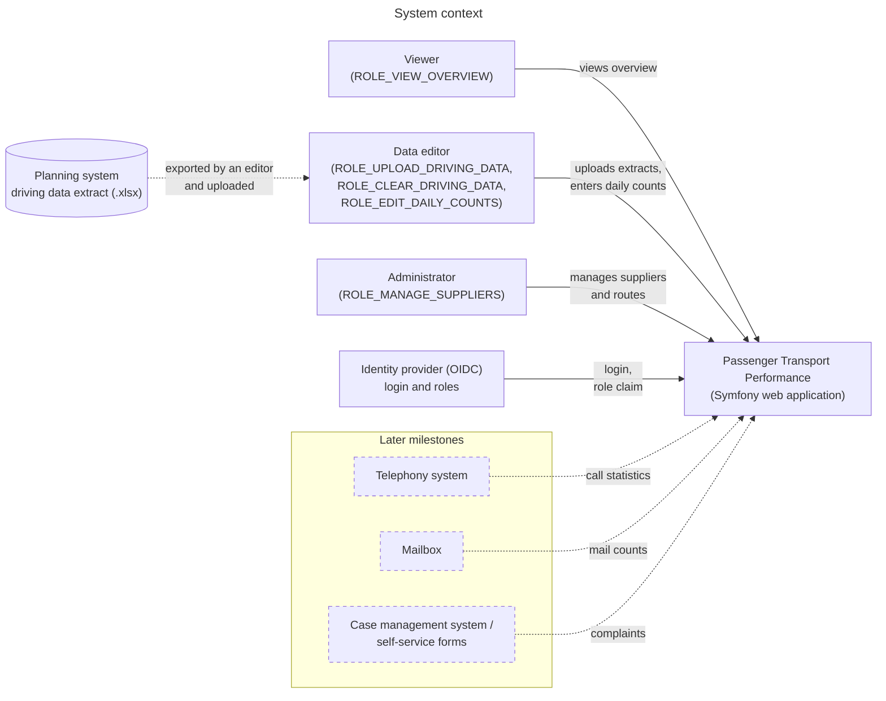
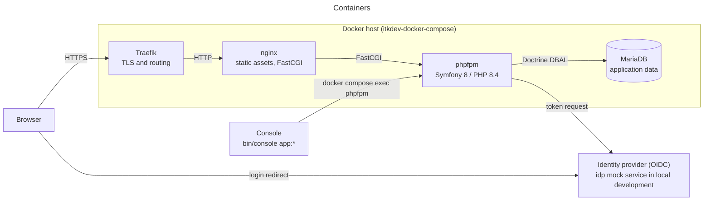
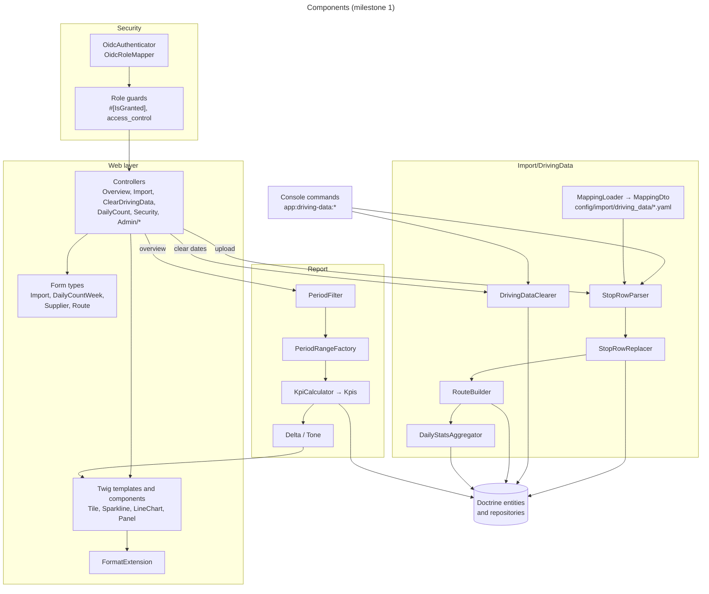
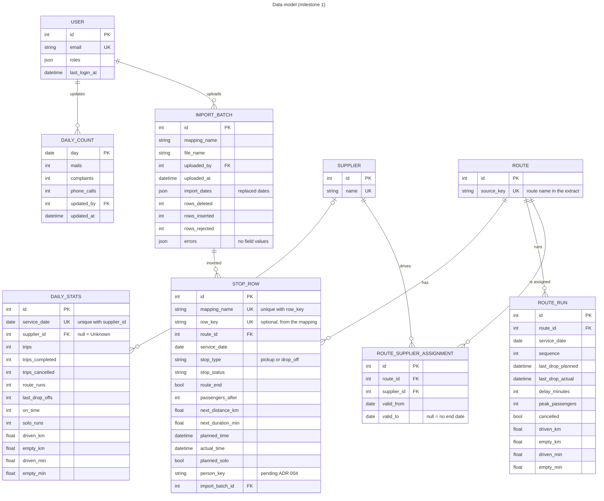
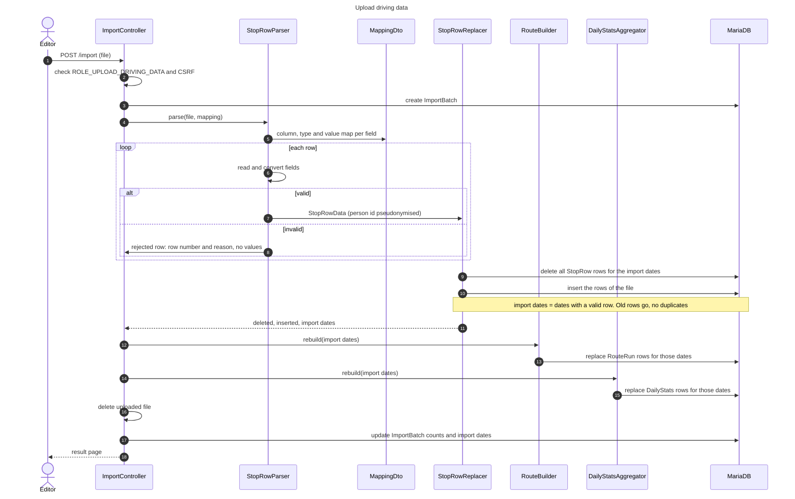
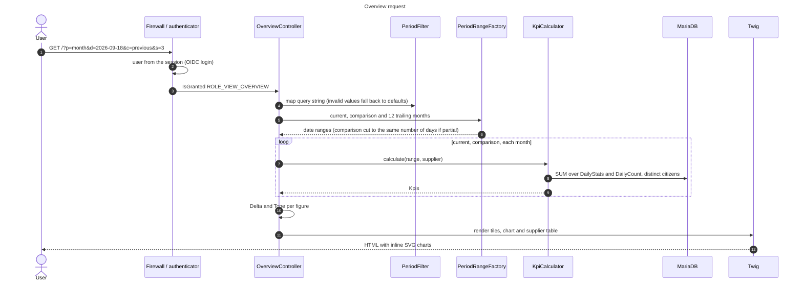
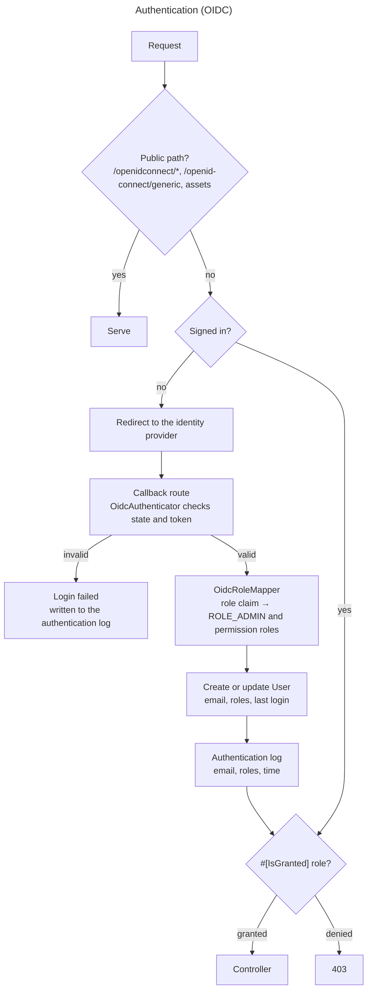

# Architecture

This document describes the architecture of Passenger Transport Performance for milestone 1:
OIDC login, upload of driving data, manual entry of daily counts, and an overview
with eight key figures. See the [README](../README.md) for what the application does.

The diagrams are Mermaid code blocks in this document. GitHub renders them. Edit a block to change
its diagram.

## Contents

- [Goals and constraints](#goals-and-constraints)
- [System context](#system-context)
- [Containers](#containers)
- [Components](#components)
- [Data model](#data-model)
- [Importing driving data](#importing-driving-data)
- [Calculating the figures](#calculating-the-figures)
- [Security](#security)
- [User interface](#user-interface)
- [Testing](#testing)
- [Deployment](#deployment)
- [Open decisions](#open-decisions)
- [Decision records](#decision-records)

## Goals and constraints

- **Correct figures first.** Every figure is calculated the same way for any period, from summed
  counts. A wrong number is the worst possible bug, so calculation code has the strictest tests.
- **No duplicates.** Re-importing data replaces all stored data for the dates in the file. The
  same data must never be counted twice, and rows that are not in a corrected file must not stay.
- **Source-independent import.** The column layout of an extract is described in a mapping file,
  not in code, so another source can be added without code changes.
- **Minimal personal data.** No names, addresses or driver data are imported. How citizen
  identifiers are handled is an [open decision](#open-decisions).
- **Simple to run.** One Symfony application and one database. No queue workers, no separate
  frontend build, no client-side chart library.
- **Every route requires a role.** Access is denied by default.

## System context



**Users:**

- **Viewers** read the overview.
- **Data editors** export extracts from the planning system and upload them, and enter the daily
  counts of mails, complaints and phone calls.
- **Administrators** manage suppliers and which supplier drives each route in each period.

These are tasks, not roles. Each task has its own permission role (see
[Authorization](#security)), so one user can do one task or many.

**Identity provider:** users sign in through the identity provider (OIDC). It also gives the
roles of each user.

**Later milestones:** the dashed systems feed the application directly, replacing manual entry.

## Containers



The application runs on the ITK Dev Docker setup (`symfony-8` template):

| Container | Role |
| --- | --- |
| Traefik | TLS termination and routing to the site |
| nginx | Serves static assets and passes PHP requests to phpfpm |
| phpfpm | The Symfony 8 application on PHP 8.4 |
| MariaDB | All application data |
| idp | Local development only: an OIDC mock service (`ghcr.io/geigerzaehler/oidc-provider-mock`) with test users |

Console commands (`app:driving-data:*`) run in the phpfpm container.

Uploads are processed synchronously within the request. A queue (Symfony Messenger) and a worker
are added only when file sizes or integrations need them.

## Components



| Namespace | Responsibility |
| --- | --- |
| `Controller` | Thin HTTP layer: checks the role, handles the form, calls a service, renders a template |
| `Form` | Hand-built form types for upload, daily counts and administration |
| `Security` | The OIDC authenticator, the mapping from the role claim to roles, and the role guards |
| `Import\DrivingData` | Reads an extract through a mapping and turns it into stored data and aggregates |
| `Report` | Period handling and the calculation of every figure |
| `Twig` | Formatting helpers and server-rendered components: tiles, sparklines, line charts, panels |
| `Command` | Console commands for imports and clearing |
| `Entity`, `Repository` | Doctrine entities and the aggregate queries |

**Rules:**

- **Logic lives in plain PHP classes.** All logic is in `Report` and `Import`, as plain classes with
  no framework dependencies where possible. Controllers, forms and commands only wire things
  together. This keeps most tests fast unit tests.
- **One import path.** The web upload and the console command use the same import services.

## Data model



**Terms:**

- **Route:** a vehicle schedule in the planning system, identified by its name in the extract. An
  administrator assigns it to a supplier for a date range. On a date with no assignment, it
  counts as "Unknown".
- **Route run:** one chain of pickups and drop-offs on a route, from the first citizen getting in
  until the vehicle is empty again. A route can have several runs a day. Punctuality and solo
  routes are measured per run.
- **Trip:** one citizen's journey from pickup to drop-off.

| Entity | Purpose |
| --- | --- |
| `User` | An account from the identity provider: email (the `upn` claim), roles from the last login, time of the last login. No password |
| `Supplier` | A transport supplier |
| `Route` | A route from the extract |
| `RouteSupplierAssignment` | The supplier that drives a route from `valid_from` to `valid_to` (empty = no end date) |
| `ImportBatch` | One upload: mapping, file name, who and when, the replaced dates, row counts, rejection reasons |
| `StopRow` | One stop from the extract, with an optional row key from the mapping. See [open decisions](#open-decisions) |
| `RouteRun` | Derived: one route run with its last drop-off, delay, peak passengers and distances |
| `DailyStats` | Derived: the counters for one date and supplier that every driving figure is summed from |
| `DailyCount` | Manually entered mails, complaints and phone calls for one date |

**Supplier assignments have dates.** A route can change supplier, for example when a contract
ends. The supplier comparison must keep the past figures of each supplier, so:

- An assignment has a `valid_from` date and an optional `valid_to` date.
- The assignments of one route must not overlap. The form validates this.
- To change supplier, end the current assignment and add a new one from the change date.
- `DailyStatsAggregator` finds the supplier for each route and date from the assignments.

**Derived tables are always rebuildable.** `RouteRun` and `DailyStats` are rebuilt from `StopRow`
for the dates an import touched. When an assignment is added, changed or deleted, `DailyStats` is
rebuilt only for the dates of the old and the new date range. Figures for other dates do not
change. The derived tables hold no information that can't be recalculated.

## Importing driving data



### Import mappings

A mapping file, `config/import/driving_data/<MAPPING_NAME>.yaml`, describes one source's extract:

- the sheet and the header row
- an optional **row key**: one or more columns that identify a row. It finds duplicate rows in
  one file
- for each application field: the source column, type, date format, value maps for codes, and
  whether it is required

`MappingLoader` validates the file with the Symfony Config component when the container is built,
so an invalid mapping stops the application from starting. It then produces an immutable
`MappingDto` value object. `StopRowParser` reads the workbook only through `MappingDto` and never
refers to column names itself. `app:driving-data:mapping:validate` checks a sample file against
a mapping before it is used.

### Pipeline

1. **Parse.** Before the first row, `ExtractInspector` checks the whole file against the
   `ExtractLimitsDto` limits. See "Data protection" in [Security](#security). Then
   `StopRowParser` reads each row and converts the fields. Invalid rows are rejected
   with their row number and a reason. A row with a date that `ImportRangeDto::contains()` does
   not accept is also rejected. The reason is a `RejectionReason` code, so field values are never
   written to messages or logs. The person id is kept as it is in the extract
   ([ADR 004](adr/004-personal-data-in-driving-data.md), proposed).
2. **Replace.** `StopRowReplacer` finds the import dates: the dates that have at least one valid
   row. It deletes all `StopRow` rows for these dates, from all mappings, and then inserts the
   rows of the file. Rows that are not in the new file are removed, and two uploads can never
   count the same date twice. A row key that occurs more than once in the file is rejected after
   the first occurrence, and a unique index on `(mapping_name, row_key)` makes this sure. It
   returns the deleted and inserted counts and the import dates.
3. **Build route runs.** `RouteBuilder` replaces `RouteRun` rows for the import dates. It orders
   each route's stops by planned time and splits them into runs at the end-of-route flag.
4. **Aggregate.** `DailyStatsAggregator` replaces `DailyStats` rows for the import dates, one
   per supplier.
5. **Clean up.** The uploaded file is deleted, and the `ImportBatch` is updated with the counts
   and the import dates.

All steps for one upload run in one database transaction. A failed import leaves the data as it
was.

**Whole days:** a file that holds only part of a day removes the other rows of that day. Users
must upload whole days. The result page lists the replaced dates.

**No rollback:** an `ImportBatch` cannot be undone. To correct a wrong upload, upload the correct
file for the same dates, or clear the dates.

### Clearing driving data

Users with `ROLE_CLEAR_DRIVING_DATA` can delete the driving data for a date range, for example
after a wrong upload:

1. The user selects a date range. The page shows the number of stop rows and route runs in it.
2. The user confirms.
3. `DrivingDataClearer` deletes `StopRow`, `RouteRun` and `DailyStats` for the range in one
   transaction. `DailyCount` does not change.
4. The application logs who cleared which range, and the deleted counts. The log has no field
   values.

`app:driving-data:clear <FROM> <TO>` uses the same service.

## Calculating the figures



**Filters:** `PeriodFilter` maps the query string (`p` period, `d` date, `c` comparison,
`s` supplier). Invalid values fall back to the defaults, so a link always works.

**Periods:** `PeriodRangeFactory` turns the filter into three sets of date ranges:

- the selected period
- the comparison period: the previous period, or the same period last year. If the selected
  period has not ended, the comparison is cut to the same number of days.
- the 12 trailing months for sparklines and the trend chart

**Calculation:** `KpiCalculator` runs one aggregate query per range and returns a `Kpis` value
object.

| Figure | Calculation |
| --- | --- |
| Empty running (%) | `SUM(empty_km) / SUM(driven_km)` |
| Trips | `SUM(trips)` |
| Citizens | Distinct citizens in the range (depends on [ADR 004](adr/004-personal-data-in-driving-data.md)) |
| Solo routes | `SUM(solo_runs)`, shown with `SUM(solo_runs) / SUM(route_runs)` |
| Punctuality (%) | `SUM(on_time) / SUM(last_drop_offs)` |
| Complaints | `SUM(complaints)`, shown with `SUM(complaints) / SUM(trips) × 1000` |
| Mails | `SUM(mails)` |
| Phone calls | `SUM(phone_calls)` |

**Rules:**

- Ratios are calculated from sums and never averaged from daily percentages.
- A zero denominator gives "no value" (shown as "–"), not zero.
- The supplier filter applies to `DailyStats`. `DailyCount` is office-wide.

**Delta and tone:** `Delta` gives the change from the comparison period, and whether it is better
or worse for that figure. `Tone` maps a value to ok, warn or danger using thresholds from one
config file.

## Security



**Authentication:** OIDC is the only login method (see
[ADR 002](adr/002-oidc-authentication.md)).

- There is one firewall with `OidcAuthenticator`. It extends `OpenIdLoginAuthenticator` from
  `itk-dev/openid-connect-bundle`.
- An anonymous user is sent to the bundle's login route under `/openidconnect`, and from there
  to the identity provider. After the login, the
  identity provider sends the user back to the callback route, `/openid-connect/generic`.
- At each login, `OidcRoleMapper` reads the role claim (`OIDC_ROLE_CLAIM`). It keeps the values
  that are `ROLE_ADMIN` or a permission role, and ignores the rest. The `User` is created or
  updated with these roles.
- The application does not edit roles. A role change in the identity provider applies at the
  next login.
- Logout ends the session in the application.
- **Authentication log:** the bundle's audit trail records each successful and failed login,
  with the IP address and the reason for a failure. `OidcAuthenticator` adds a record with the
  email and the roles at each login. Both go to the `openid_connect_audit` channel, which Monolog
  writes to `var/log/openid_connect_audit.log`.
- Local development uses the `idp` mock service. Functional tests sign in with `loginUser()`.

**Authorization:**

- Each part of the application has its own permission role. Controllers check only these:

  | Permission role | Grants |
  | --- | --- |
  | `ROLE_VIEW_OVERVIEW` | The overview |
  | `ROLE_UPLOAD_DRIVING_DATA` | Upload of driving data |
  | `ROLE_CLEAR_DRIVING_DATA` | Clearing the driving data for a date range |
  | `ROLE_EDIT_DAILY_COUNTS` | The daily counts form |
  | `ROLE_MANAGE_SUPPLIERS` | Suppliers, routes and route → supplier assignments |

- `ROLE_ADMIN` gives all permission roles. At first, users get `ROLE_ADMIN` only. Narrower
  access later needs only other values in the role claim, or a new bundle in `role_hierarchy`.

  ```yaml
  role_hierarchy:
    ROLE_ADMIN:
      - ROLE_VIEW_OVERVIEW
      - ROLE_UPLOAD_DRIVING_DATA
      - ROLE_CLEAR_DRIVING_DATA
      - ROLE_EDIT_DAILY_COUNTS
      - ROLE_MANAGE_SUPPLIERS
  ```

- Every signed-in user also has `ROLE_USER`. It grants nothing alone.
- Every controller has a class-level `#[IsGranted]` with a permission role.
- `access_control` denies everything to anonymous users except the OIDC routes
  (`/openidconnect/*` and `/openid-connect/generic`) and the assets.
- A test walks the router. It fails if an application route has no `IsGranted`, or if it checks
  `ROLE_ADMIN` or `ROLE_USER`.

**Data protection:**

- Forms use CSRF tokens.
- Uploads are limited to `.xlsx` and a maximum size, and are deleted after processing.
- The parser reads the extract with OpenSpout, which streams one row at a time. Before OpenSpout
  opens the file, `ExtractInspector` checks the file size and the total uncompressed size of the
  xlsx archive. Then it reads each XML file in the archive one node at a time, and checks the
  row numbers and the columns against configurable limits (ASVS V12.1.2). A file above a limit
  gives no rows. The inspector reads every XML file, because OpenSpout does not check the
  `spans` of a row: a small file can make one row use all the memory.
- The inspector rejects XML with a `DOCTYPE`, so an extract cannot use external entities (XXE,
  ASVS V5.5.2). OpenSpout does not read an external entity, but it ignores a cell with one. The
  tests keep this protection if a new version of OpenSpout changes.
- The import runs synchronously in the request. The limits above keep it short.
- Rejection reasons and logs never contain field values from the extract.

**Passwords and multi-factor authentication** (ASVS V2.1, V4.3.1): the application stores no
passwords. The identity provider applies its password rules and multi-factor authentication.

**Dependencies** (ASVS V14.2.1): the PR workflow runs `composer audit`. Dependabot is an
option for a later milestone.

**HTTP security headers** (ASVS V14.4): `nelmio/security-bundle` adds these headers to every
response. The configuration is in the repository, and a functional test checks it.

| Header | Value |
| --- | --- |
| `Strict-Transport-Security` | `max-age=31536000; includeSubDomains` (in `prod` only) |
| `Content-Security-Policy` | `default-src 'self'; script-src 'self'; style-src 'self'; img-src 'self' data:; object-src 'none'; base-uri 'self'; form-action 'self'; frame-ancestors 'none'` |
| `X-Content-Type-Options` | `nosniff` |
| `Referrer-Policy` | `same-origin` |

**Effects of the Content Security Policy:**

- Templates have no inline scripts, no inline event handlers and no `style` attributes.
- The server-rendered SVG charts use classes and SVG presentation attributes for styling.
- The `popover` help texts need no script.
- If a page needs an inline script later, it uses a nonce from the bundle.

## User interface

**Rendering:**

- Server-rendered Twig with AssetMapper. There is no Node build step.
- Styling comes from the itkaarhus design system, mapped in AssetMapper as `itkaarhus-ds`, plus
  the prototype's stylesheet ported to `assets/styles/app.css`.
- Charts are Twig components that render inline SVG on the server. Each chart includes a hidden
  data table for screen readers. No chart JavaScript is used.
- Help texts (**?**) use the native HTML `popover` attribute.

**Language:** the UI is in Danish. Texts live in `translations/messages+intl-icu.da.yaml`, and
`FormatExtension` formats numbers, percentages, percentage points, deltas and period labels.

**Filters:** all state is in the URL, so every view can be bookmarked and shared.

## Testing

The project is developed test first, with 100 % line coverage and mutation testing. See
[Tests](../README.md#tests) in the README for the full rules.

| Layer | What | Tools |
| --- | --- | --- |
| Unit | `Report`, `Import`, value objects, `FormatExtension` | PHPUnit |
| Integration | Repositories and aggregate queries, replacement and clearing, commands | `KernelTestCase`, MariaDB, `dama/doctrine-test-bundle` |
| Functional | Every route × role, forms, the OIDC login with a stubbed identity provider, upload end to end, the overview | `WebTestCase` |

**Mutation testing (Infection):**

- `src/Report` and `src/Import` require a covered MSI of 100 %. The rest of the mutated code
  requires 80 %.
- Controllers, form types and Twig components are not mutated.
- Pull requests run it on changed lines. Release branches run it on the whole code base.

## Deployment

**Pipelines:** Woodpecker deploys with `itkdev/ansible-plugin`:

- a push to `release/*` or `hotfix/*` deploys to staging
- a GitHub release on `main` deploys to production

**Deploy steps:** each deploy updates the code and runs `composer install --no-dev`, the
Doctrine migrations and `cache:clear` in the server's phpfpm container.

**Configuration:** server configuration lives in `.env.local` on the server. Woodpecker secrets
hold the connection details.

**CI:** GitHub Actions runs coding standards, PHPStan, tests with the coverage gate, mutation
testing and the diagram check on every pull request.

## Open decisions

- **Personal data in driving data** ([ADR 004](adr/004-personal-data-in-driving-data.md), draft).
  - This decides whether `StopRow` and the pseudonymised person key are stored, kept for a
    correction window, or replaced by aggregates and distinct-count sketches.
  - The data model above shows the current working assumption (rows with a pseudonymised key).
  - The product owner in the transport office decides, with the data protection adviser.
  - It must be decided before the extract parser is built (task M1-15).
- **Whole days.** Does each extract hold whole days? The replacement of whole dates depends on
  it.
- **Role claim.** Which claim holds the roles, and which values does the identity provider
  send? Which group is assigned to the application? IT operations sets this up before go-live
  (task M1-28).

## Decision records

See [`adr/`](adr/README.md):

- [001: Stack](adr/001-stack.md)
- [002: OIDC authentication with roles from the identity provider](adr/002-oidc-authentication.md)
- [003: Driving data import with mappings and replacement of whole dates](adr/003-driving-data-import-mapping-and-overwrite.md)
- [004: Personal data in driving data](adr/004-personal-data-in-driving-data.md)
