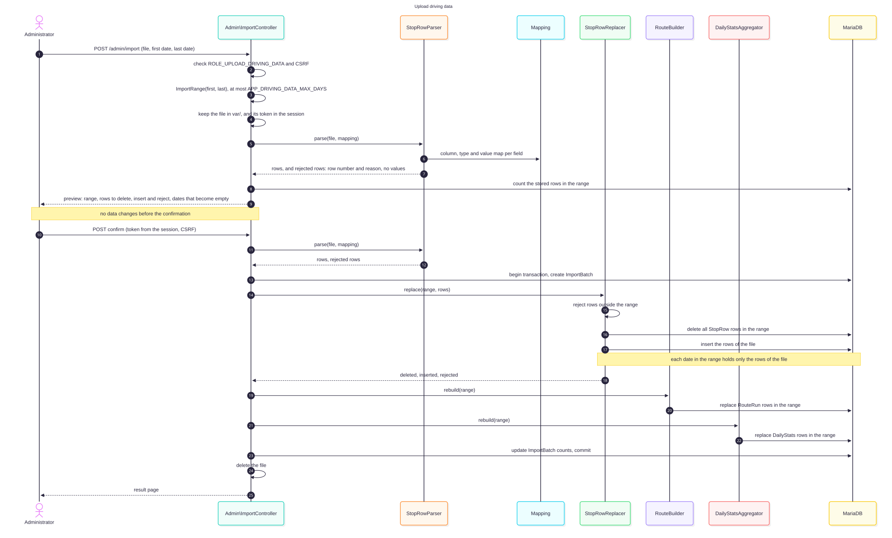
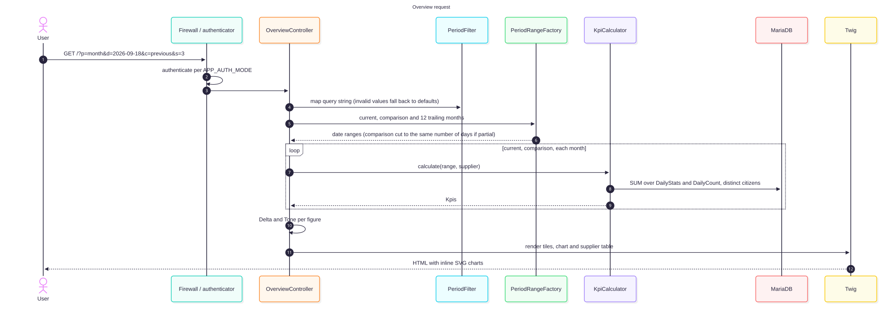

# Architecture

This document describes the architecture of Passenger Transport Performance for milestone 1:
OIDC login, upload of driving data, manual entry of daily counts, and an overview
with eight key figures. See the [README](../README.md) for what the application does and
[the plan](plan.md) for how it is built.

The diagrams are Mermaid files in [`diagrams/`](diagrams/). Each image links to its source. Run
`task docs:diagrams` after changing a source; CI fails if a rendered SVG is out of date.

## Contents

- [Goals and constraints](#goals-and-constraints)
- [System context](#system-context)
- [Containers](#containers)
- [Components](#components)
- [Data model](#data-model)
- [Importing driving data](#importing-driving-data)
- [Calculating the figures](#calculating-the-figures)
- [Security](#security)
- [User interface](#user-interface)
- [Testing](#testing)
- [Deployment](#deployment)
- [Open decisions](#open-decisions)
- [Decision records](#decision-records)

## Goals and constraints

- **Correct figures first.** Every figure is calculated the same way for any period, from summed
  counts. A wrong number is the worst possible bug, so calculation code has the strictest tests.
- **No duplicates.** Re-importing data replaces all stored data in the date range of the upload.
  The same data must never be counted twice, and rows that are not in a corrected file must not
  stay.
- **Configurable column layout.** A mapping file gives the column names, the code values and the
  formats of an extract, so a change of these needs no code change. A new field needs code (see
  [Import mappings](#import-mappings)).
- **Minimal personal data.** No names, addresses, free text or driver data are imported. The
  person id is kept only to count citizens. The decision is proposed, not accepted (see
  [open decisions](#open-decisions)).
- **Simple to run.** One Symfony application and one database. No queue workers, no separate
  frontend build, no client-side chart library.
- **Every route requires a role.** Access is denied by default.

## System context

[](diagrams/context.mmd)

**Users:**

- **Viewers** read the overview.
- **Data editors** enter the daily counts of mails, complaints and phone calls.
- **Administrators** export extracts from the planning system and upload them, clear the
  driving data for a date, and manage suppliers and which supplier drives each route in each
  period. The identity provider manages the users.

These are tasks, not roles. Each task has its own permission role (see
[Authorization](#security)), so one user can do one task or many.

**Identity provider:** users sign in through the identity provider (OIDC). It also gives the
roles of each user.

**Later milestones:** the dashed systems feed the application directly, replacing manual entry.

## Containers

[](diagrams/containers.mmd)

The application runs on the ITK Dev Docker setup (`symfony-8` template):

| Container | Role |
| --- | --- |
| Traefik | TLS termination and routing to the site |
| nginx | Serves static assets and passes PHP requests to phpfpm |
| phpfpm | The Symfony 8 application on PHP 8.4 |
| MariaDB | All application data |
| idp | Local development only: an OIDC mock service (`ghcr.io/soluto/oidc-server-mock`) with test users |

Console commands (`app:driving-data:*`) run in the phpfpm container.

Uploads are processed synchronously within the request. A queue (Symfony Messenger) and a worker
are added only when file sizes or integrations need them.

## Components

[](diagrams/components.mmd)

| Namespace | Responsibility |
| --- | --- |
| `Controller` | Thin HTTP layer: checks the role, handles the form, calls a service, renders a template |
| `Form` | Hand-built form types for upload, daily counts and administration |
| `Security` | The OIDC authenticator, the mapping from the role claim to roles, and the role guards |
| `Import\DrivingData` | Reads an extract through a mapping and turns it into stored data and aggregates |
| `Report` | Period handling and the calculation of every figure |
| `Twig` | Formatting helpers and server-rendered components: tiles, sparklines, line charts, panels |
| `Command` | Console commands for imports and clearing |
| `Entity`, `Repository` | Doctrine entities and the aggregate queries |

**Rules:**

- **Logic lives in plain PHP classes.** All logic is in `Report` and `Import`, as plain classes with
  no framework dependencies where possible. Controllers, forms and commands only wire things
  together. This keeps most tests fast unit tests.
- **One import path.** The web upload and the console command use the same import services.

## Data model

[](diagrams/data-model.mmd)

**Terms:**

- **Route:** a vehicle schedule in the planning system, identified by its name in the extract. An
  administrator assigns it to a supplier for a date range. On a date with no assignment, it
  counts as "Unknown".
- **Route run:** one chain of pickups and drop-offs on a route, from the first citizen getting in
  until the vehicle is empty again. A route can have several runs a day. The extract gives each
  run a block number. Punctuality and solo routes are measured per run.
- **Trip:** one citizen's journey from pickup to drop-off.

| Entity | Purpose |
| --- | --- |
| `User` | An account from the identity provider: username, roles from the last login, time of the last login. No password |
| `Supplier` | A transport supplier |
| `Route` | A route from the extract |
| `RouteSupplierAssignment` | The supplier that drives a route from `valid_from` to `valid_to` (empty = no end date) |
| `ImportBatch` | One upload: mapping, file name, who and when, the replaced date range, row counts, rejection reasons |
| `StopRow` | One stop from the extract, with an optional row key from the mapping. See [open decisions](#open-decisions) |
| `RouteRun` | Derived: one route run with its last drop-off, delay, peak passengers and distances |
| `DailyStats` | Derived: the counters for one date and supplier that every driving figure is summed from |
| `DailyCount` | Manually entered mails, complaints and phone calls for one date |

**Supplier assignments have dates.** A route can change supplier, for example when a contract
ends. The supplier comparison must keep the past figures of each supplier, so:

- An assignment has a `valid_from` date and an optional `valid_to` date.
- The assignments of one route must not overlap. The form validates this.
- To change supplier, end the current assignment and add a new one from the change date.
- `DailyStatsAggregator` finds the supplier for each route and date from the assignments.

**Derived tables are always rebuildable.** `RouteRun` and `DailyStats` are rebuilt from `StopRow`
for the dates an import touched. When an assignment is added, changed or deleted, `DailyStats` is
rebuilt only for the dates of the old and the new date range. Figures for other dates do not
change. The derived tables hold no information that can't be recalculated.

## Importing driving data

[](diagrams/upload-sequence.mmd)

### Import mappings

A mapping file, `config/import/driving_data/<MAPPING_NAME>.yaml`, describes one source's extract:

- the sheet and the header row
- an optional **row key**: one or more source columns that identify a row. It finds duplicate
  rows in one file
- for each application field: the source column, type, date format, value maps for codes, and
  whether it is required

`MappingLoader` validates the file with the Symfony Config component when the container is built,
so an invalid mapping stops the application from starting. It then produces an immutable
`Mapping` value object. `StopRowParser` reads the workbook only through `Mapping` and never
refers to column names itself. `app:driving-data:mapping:validate` checks a sample file against
a mapping before it is used.

**What a mapping can change:** the column names, the code values and the formats of the fixed
application fields. Each application field must have one source column. These changes need code:

- a field that the extract does not have
- a field that is made from more than one column, or a column that holds more than one field
- a new application field

### The reference extract

A reference extract from the planning system gives the layout for the `default` mapping. The
extract is not in Git, and the docs contain no values from it.

**Layout:**

- One sheet. Row 1 is a title, row 2 is empty, and row 3 has the column headers.
- One row for each stop. Each trip has a pickup row and a drop-off row.
- The extract holds one service day. The date is in its own column, and the times have no date.
- The columns with names, addresses and places are empty in the reference extract.

**Columns in the `default` mapping:**

| Field | Column | Type in the extract | Note |
| --- | --- | --- | --- |
| row key | `RouteStopID` | text | Unique for each row. |
| `route` | `RouteName` | text | To be confirmed: see "Route column" in [open decisions](#open-decisions). |
| `person_id` | `PersonID` | text | [ADR 004](adr/004-personal-data-in-driving-data.md) |
| `service_date` | `Date` | text, `Y-m-d` | The service day of all the times in the row. |
| `run` | `blocknumber` | integer | The route run. A route run is the route, the date and the run. |
| `stop_type` | `StopType` | text code | Two codes: pickup and drop-off. |
| `stop_status` | `Status` | text code | Three codes: completed, cancelled, and no registration (`pending`). |
| `passengers_after` | `passengersaftercancel` | integer | The passengers after the stop, when the cancellations are removed. |
| `next_distance_km` | `ToNextDistance` | decimal | Kilometres. Can be empty. |
| `next_duration_min` | `ToNextDuration` | decimal | Minutes. Can be empty when the distance is not. |
| `planned_time` | `PlannedArrival` | Excel time, `[hh]:mm:ss` | A wall-clock time on `service_date`. Can be 24:00 or more (see [Times](#times)). |
| `actual_time` | `StatusUpdateTime` | Excel date and time | Empty when the stop has no registration. |
| `planned_solo` | `kørselstype` | text code | Two codes: solo and shared. |

**Why the run comes from `blocknumber`:** the extract also has a column for the start and a column
for the end of a block. In the reference extract, one run has a start but no end. A split on the
end flag joins that run with the next run. The block number gives each run directly.

**Columns that are not imported:**

- Names, addresses, postcodes, towns and places. They are empty in the reference extract.
- `Labels` and `Comment`. They can hold the needs of a citizen or free text, and that can be
  health data ([ADR 004](adr/004-personal-data-in-driving-data.md)).
- The ids of addresses, locations, places, trips and trip requests.
- The other planning columns, for example the requested times, the service times and the paths.

**Columns for milestone 2** (not imported in milestone 1):

- The cancellation columns: the cancellation id, the time of the cancellation, the notice in
  minutes (negative when the cancellation came after the planned time), and whether the notice
  was in time.
- `prisprminut`, the price per minute, for the estimated cost of empty running.
- `passengers`, the passengers after the stop before the cancellations are removed.

### Times

A `time` field is a time of day in an Excel time cell. It is a wall-clock time on the
`service_date` of the row:

- A time of 24:00 or more is on the next day. For example, 25:10 is 01:10 on the day after
  `service_date`.
- The import does not convert times to UTC, and stores them with no time zone. A change to or
  from daylight saving time in Europe/Copenhagen never moves a stored time.
- The import does not correct a time that does not exist, or that exists two times, on the
  night of a change.
- Known limit: a delay across a change at night can be one hour wrong. Few runs drive at that
  time.

### Date range

The user enters the first and the last date of the export, together with the file. `ImportRange`
holds the two dates. The import replaces exactly this range
([ADR 003](adr/003-driving-data-import-mapping-and-overwrite.md)):

- A date in the range with no rows in the file becomes empty. This includes the first and the
  last date.
- A row with a date outside the range is rejected. A wrong date in one row cannot change other
  dates. `ImportRange::contains()` is the only check. `StopRowParser` calls it for each row, so
  the preview and the import reject the same rows.
- The range can be at most `APP_DRIVING_DATA_MAX_DAYS` days (default 31). A longer range is
  rejected, and no data changes.

### Pipeline

1. **Preview.** The upload keeps the file in `var/` with a random name, and keeps its token in
   the session. The parser reads the file, and the page shows the range, the rows to delete,
   insert and reject, and the dates that become empty. No data changes.
2. **Confirm.** The user confirms. The controller removes the token from the session before the
   import, so the token works one time only. A second confirmation, for example after a double
   click, finds no token. It shows a message and imports nothing. The steps below parse the file
   again and import it. If the user cancels, the file is deleted.
3. **Parse.** `StopRowParser` reads each row and converts the fields. Invalid rows are rejected
   with their row number and a reason. A row with a date that `ImportRange::contains()` does not
   accept is also rejected. Field values are never written to messages or logs. The person id is
   kept as it is in the extract ([ADR 004](adr/004-personal-data-in-driving-data.md), proposed).
4. **Replace.** `StopRowReplacer` deletes all `StopRow` rows in the range, from all mappings, and
   then inserts the parsed rows. It does not check the range again. Rows that are not in the new
   file are removed, and two uploads can never count the same date twice. A row key that occurs
   more than once in the file is rejected after the first occurrence, and a unique index on
   `(mapping_name, row_key)` makes this sure. It returns the deleted and inserted counts.
5. **Build route runs.** `RouteBuilder` replaces `RouteRun` rows for the range. It groups the
   stops by route, date and run (the block number in the extract), and orders the stops of each
   run by planned time.
6. **Aggregate.** `DailyStatsAggregator` replaces `DailyStats` rows for the range, one per
   supplier.
7. **Clean up.** The uploaded file is deleted, and the `ImportBatch` is updated with the counts
   and the range.

Steps 3 to 7 run in one database transaction. A failed import leaves the data as it was.

**Unconfirmed files:** `app:driving-data:purge-uploads` deletes the upload files that are older
than one hour. A cron job on the server runs it every 15 minutes, and each new upload also runs
it. A confirmation after the purge shows that the upload has expired, and imports nothing.

**Whole days and the date range:** a file that holds only part of a day removes the other rows of
that day. A range that is longer than the export empties the extra dates. Users must upload whole
days and enter the range of the export. The preview lists the dates that become empty.

**No rollback:** an `ImportBatch` cannot be undone. To correct a wrong upload, upload the correct
file for the same range, or clear the dates.

### Clearing driving data

The upload page lists the uploaded dates, one month at a time. Each date shows the number of stop
rows and route runs, and the last upload (file name, who, when). Users with
`ROLE_CLEAR_DRIVING_DATA` can delete the driving data for a date, for example after a wrong
upload. The list is on the upload page, so these users also need `ROLE_UPLOAD_DRIVING_DATA`.
`ROLE_ADMIN` gives both roles.

1. The user selects **Clear** for a date.
2. The user confirms.
3. `DrivingDataClearer` deletes `StopRow`, `RouteRun` and `DailyStats` for the date in one
   transaction. `DailyCount` does not change.
4. The application logs who cleared which date, and the deleted counts. The log has no field
   values.

`app:driving-data:clear <FROM> <TO>` uses the same service to clear a date range.

## Calculating the figures

[](diagrams/overview-sequence.mmd)

**Filters:** `PeriodFilter` maps the query string (`p` period, `d` date, `c` comparison,
`s` supplier). Invalid values fall back to the defaults, so a link always works.

**Periods:** `PeriodRangeFactory` turns the filter into three sets of date ranges:

- the selected period
- the comparison period: the previous period, or the same period last year. If the selected
  period has not ended, the comparison is cut to the same number of days.
- the 12 trailing months for sparklines and the trend chart

**Calculation:** `KpiCalculator` runs one aggregate query per range and returns a `Kpis` value
object.

| Figure | Calculation |
| --- | --- |
| Empty running (%) | `SUM(empty_km) / SUM(driven_km)` |
| Trips | `SUM(trips)` |
| Citizens | `COUNT(DISTINCT person_id)` over the `StopRow` rows in the range ([ADR 004](adr/004-personal-data-in-driving-data.md)) |
| Solo routes | `SUM(solo_runs)`, shown with `SUM(solo_runs) / SUM(route_runs)` |
| Punctuality (%) | `SUM(on_time) / SUM(last_drop_offs)` |
| Complaints | `SUM(complaints)`, shown with `SUM(complaints) / SUM(trips) × 1000` |
| Mails | `SUM(mails)` |
| Phone calls | `SUM(phone_calls)` |

**Rules:**

- Ratios are calculated from sums and never averaged from daily percentages.
- A zero denominator gives "no value" (shown as "–"), not zero.
- The supplier filter applies to `DailyStats`. `DailyCount` is office-wide.

**Delta and tone:** `Delta` gives the change from the comparison period, and whether it is better
or worse for that figure. `Tone` maps a value to ok, warn or danger using thresholds from one
config file.

## Security

[](diagrams/authentication.mmd)

**Authentication:** OIDC is the only login method (see
[ADR 002](adr/002-oidc-authentication.md)).

- There is one firewall with `OidcAuthenticator`. It extends `OpenIdLoginAuthenticator` from
  `itk-dev/openid-connect-bundle`.
- An anonymous user is sent to the identity provider. After the login, the identity provider
  sends the user back to the callback route.
- At each login, `OidcRoleMapper` reads the role claim (`OIDC_ROLE_CLAIM`). It keeps the values
  that are `ROLE_ADMIN` or a permission role, and ignores the rest. The `User` is created or
  updated with these roles.
- The application does not edit roles. A role change in the identity provider applies at the
  next login.
- Logout ends the session in the application.
- Local development uses the `idp` mock service. Functional tests sign in with `loginUser()`.

**Authorization:**

- Each part of the application has its own permission role. Controllers check only these:

  | Permission role | Grants |
  | --- | --- |
  | `ROLE_VIEW_OVERVIEW` | The overview |
  | `ROLE_UPLOAD_DRIVING_DATA` | Upload of driving data |
  | `ROLE_CLEAR_DRIVING_DATA` | Clearing the driving data for a date on the upload page. The user also needs `ROLE_UPLOAD_DRIVING_DATA` to open the page |
  | `ROLE_EDIT_DAILY_COUNTS` | The daily counts form |
  | `ROLE_MANAGE_SUPPLIERS` | Suppliers, routes and route → supplier assignments |

- `ROLE_ADMIN` gives all permission roles. At first, users get `ROLE_ADMIN` only. Narrower
  access later needs only other values in the role claim, or a new bundle in `role_hierarchy`.

  ```yaml
  role_hierarchy:
    ROLE_ADMIN:
      - ROLE_VIEW_OVERVIEW
      - ROLE_UPLOAD_DRIVING_DATA
      - ROLE_CLEAR_DRIVING_DATA
      - ROLE_EDIT_DAILY_COUNTS
      - ROLE_MANAGE_SUPPLIERS
  ```

- Every signed-in user also has `ROLE_USER`. It grants nothing alone.
- Every controller has a class-level `#[IsGranted]` with a permission role.
- `access_control` denies everything to anonymous users except the OIDC login and callback
  routes and the assets.
- A test walks the router. It fails if an application route has no `IsGranted`, or if it checks
  `ROLE_ADMIN` or `ROLE_USER`.

**Data protection:**

- Forms use CSRF tokens.
- Uploads are limited to `.xlsx` and a maximum size. The file is kept in `var/`, outside the
  public folder, until the user confirms or cancels. The scheduled purge deletes a file that is
  older than one hour (see [Pipeline](#pipeline)). The extract can hold health data, so the file
  must not stay.
- The confirmation uses a token from the user's session, so a user cannot confirm the upload of
  another user. The token works one time only, so a double click cannot import the file two
  times.
- The parser reads the extract with OpenSpout, which streams one row at a time. It has
  configurable limits for the number of rows and columns, and stops at the first row or column
  above a limit (ASVS V12.1.2).
- The parser rejects XML with a `DOCTYPE`, so an extract cannot use external entities (XXE,
  ASVS V5.5.2).
- The import runs synchronously in the request. The limits above keep it short.
- Rejection reasons and logs never contain field values from the extract.

**Passwords and multi-factor authentication** (ASVS V2.1, V4.3.1): the application stores no
passwords. The identity provider applies its password rules and multi-factor authentication.

**Dependencies** (ASVS V14.2.1): the PR workflow runs `composer audit`. Dependabot is an
option for a later milestone.

**HTTP security headers** (ASVS V14.4): `nelmio/security-bundle` adds these headers to every
response. The configuration is in the repository, and a functional test checks it.

| Header | Value |
| --- | --- |
| `Strict-Transport-Security` | `max-age=31536000; includeSubDomains` (in `prod` only) |
| `Content-Security-Policy` | `default-src 'self'; script-src 'self'; style-src 'self'; img-src 'self' data:; object-src 'none'; base-uri 'self'; form-action 'self'; frame-ancestors 'none'` |
| `X-Content-Type-Options` | `nosniff` |
| `Referrer-Policy` | `same-origin` |

**Effects of the Content Security Policy:**

- Templates have no inline scripts, no inline event handlers and no `style` attributes.
- The server-rendered SVG charts use classes and SVG presentation attributes for styling.
- The `popover` help texts need no script.
- If a page needs an inline script later, it uses a nonce from the bundle.

## User interface

**Rendering:**

- Server-rendered Twig with AssetMapper. There is no Node build step.
- Styling comes from the itkaarhus design system, mapped in AssetMapper as `itkaarhus-ds`, plus
  the prototype's stylesheet ported to `assets/styles/app.css`.
- Charts are Twig components that render inline SVG on the server. Each chart includes a hidden
  data table for screen readers. No chart JavaScript is used.
- Help texts (**?**) use the native HTML `popover` attribute.
- The page loads no file from an external host. The design system has no font files, so the
  layout uses the fallback fonts of `--itkaarhus-font-sans` (Helvetica Neue, Arial). Inter has
  the SIL Open Font License, so a later task can add it to `assets/fonts`.

**Menu:** `MainMenu` defines the items, and `MenuBuilder` removes the items that the user must
not see. An item is visible only if its route exists and the user has its permission role. A
group is visible only if at least one child is visible. `MainMenu` already has the items for
daily counts and suppliers, so each item shows when its task adds the route.

The menu has these items:

- Overview
- Daily counts
- Administration: Upload driving data, and Suppliers and routes. M1-13 adds the group, and M1-19
  adds the upload item.

**Language:** the UI is in Danish. Texts live in `translations/messages+intl-icu.da.yaml`, and
`FormatExtension` formats numbers, percentages, percentage points, deltas and period labels.

**Filters:** all state is in the URL, so every view can be bookmarked and shared.

## Testing

The project is developed test first, with 100 % line coverage and mutation testing. See the
[plan](plan.md#development-approach-test-driven-100--coverage-mutation-testing) for the full rules.

| Layer | What | Tools |
| --- | --- | --- |
| Unit | `Report`, `Import`, value objects, `FormatExtension` | PHPUnit |
| Integration | Repositories and aggregate queries, replacement and clearing, commands | `KernelTestCase`, MariaDB, `dama/doctrine-test-bundle` |
| Functional | Every route × role, forms, the OIDC login with a stubbed identity provider, upload end to end, a second confirmation of one upload, the overview | `WebTestCase` |

**Mutation testing (Infection):**

- `src/Report` and `src/Import` require a covered MSI of 100 %. The rest of the mutated code
  requires 80 %.
- Controllers, form types and Twig components are not mutated.
- Pull requests run it on changed lines. Release branches run it on the whole code base.

### Test data

The tests and the local site use generated extracts. No real extract is committed.

- **The generator:** `ExtractWriter` writes an `.xlsx` with the layout of the `default` mapping:
  the rows above the header, the column headers and the code values. The input uses the
  application field names and values, for example `pickup` and `completed`. So a change of the
  mapping changes the files, and the scenarios stay the same.
- **Scenarios:** YAML files in `tests/fixtures/driving_data/`. Each scenario has an `expected`
  section with the totals worked out by hand. The test compares the result of the import with
  these totals.
- **Bad data:** a stop can give a raw cell value, so that a scenario can hold a bad date, an
  unknown code or text in a number column. A scenario can also leave out a column.
- **Times:** the parser tests include times of 24:00 or more, and the spring and autumn dates of
  the change to and from daylight saving time in Europe/Copenhagen (see [Times](#times)).
- **Development dataset:** `DevDatasetGenerator` makes 13 months of data from a seed, one file
  for each calendar month. The routes and the suppliers are the same as in the development
  fixtures, so the overview shows figures for each supplier.
- **Maximum range:** a development file holds one calendar month, so it has at most 31 days. This
  is the default of `APP_DRIVING_DATA_MAX_DAYS`. If the setting is less than 31, the upload
  rejects these files.
- **Files:** `task fixtures:extracts` writes all files to `var/fixtures/driving_data/`. Upload
  them by hand to test the upload page.

## Deployment

**Pipelines:** Woodpecker deploys with `itkdev/ansible-plugin`:

- a push to `release/*` or `hotfix/*` deploys to staging
- a GitHub release on `main` deploys to production

**Deploy steps:** each deploy updates the code and runs `composer install --no-dev`, the
Doctrine migrations and `cache:clear` in the server's phpfpm container.

**Configuration:** server configuration lives in `.env.local` on the server. Woodpecker secrets
hold the connection details.

**Cron:** a cron job on the server runs `app:driving-data:purge-uploads` every 15 minutes in the
phpfpm container.

**CI:** GitHub Actions runs coding standards, PHPStan, tests with the coverage gate, mutation
testing and the diagram check on every pull request.

## Open decisions

- **Personal data in driving data** ([ADR 004](adr/004-personal-data-in-driving-data.md),
  proposed).
  - The proposal: `StopRow` keeps the person id from the extract, with no HMAC. The data model
    above shows it.
  - The product owner in the transport office decides, with the data protection adviser.
  - The parser implements the proposal. The decision must be accepted before go-live.
- **Whole days.** Does each extract hold whole days? The replacement of the date range depends
  on it. A partial day removes the other rows of that day. The product owner in the transport
  office answers before the replacement is built.
- **All routes in one extract.** Does one extract hold all the routes of a day, or only one area
  or contract? The import replaces all stop rows in the date range. If the extracts are per
  area, an upload for one area deletes the other areas. Then the replacement must be limited to
  the routes or the area of the file ([ADR 003](adr/003-driving-data-import-mapping-and-overwrite.md)).
  The product owner in the transport office answers before the replacement is built.
- **Maximum range.** What can the planning system export? Evaluate the default of
  `APP_DRIVING_DATA_MAX_DAYS` (31 days) after a test export. The developer answers this with the
  transport office before go-live.
- **Route column.** Which column identifies a route: the route name or the route id? The route id
  can be an id for one day only. The `default` mapping uses the route name until this is
  confirmed. The product owner in the transport office answers before the route administration
  is built.
- **Supplier mapping.** How do we know which company drives each route? For example, is there a
  list from the transport office, a field in the planning system, or a part of the route name?
  Administrators keep the assignments until a source is known. The product owner answers before
  go-live.
- **Booked trips.** Some trips are booked outside the fixed routes, and have a common route name.
  Who drives them? Can more than one supplier drive them? With one route for all of them, they
  get one supplier assignment. The product owner in the transport office answers before the
  route administration is built.
- **Stops with no registration.** How do the figures treat a stop that has no status
  registration from the driver (`pending`)? The proposal: it counts as a trip, because it is not
  cancelled. A run whose last drop-off has no actual time is not counted for punctuality. The
  product owner in the transport office answers before the daily stats are built.
- **Actual time.** Is `StatusUpdateTime` the actual time of the stop? It is the time of the
  status registration by the driver. The mapping uses it until the product owner answers.
- **Role claim.** Which claim holds the roles, and which values does the identity provider
  send? Which group is assigned to the application? IT operations sets this up before go-live.

## Decision records

See [`adr/`](adr/README.md):

- [001: Stack](adr/001-stack.md)
- [002: OIDC authentication with roles from the identity provider](adr/002-oidc-authentication.md)
- [003: Driving data import with mappings and replacement of the entered date range](adr/003-driving-data-import-mapping-and-overwrite.md)
- [004: Personal data in driving data](adr/004-personal-data-in-driving-data.md)
