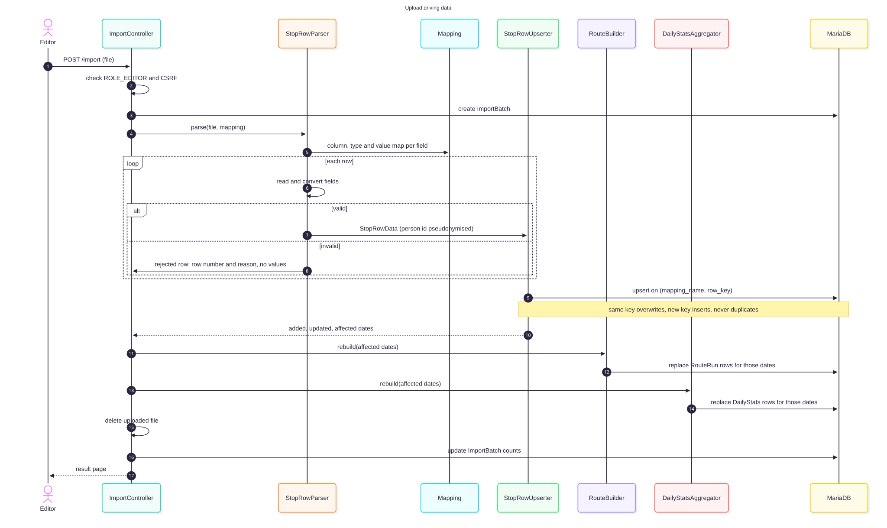
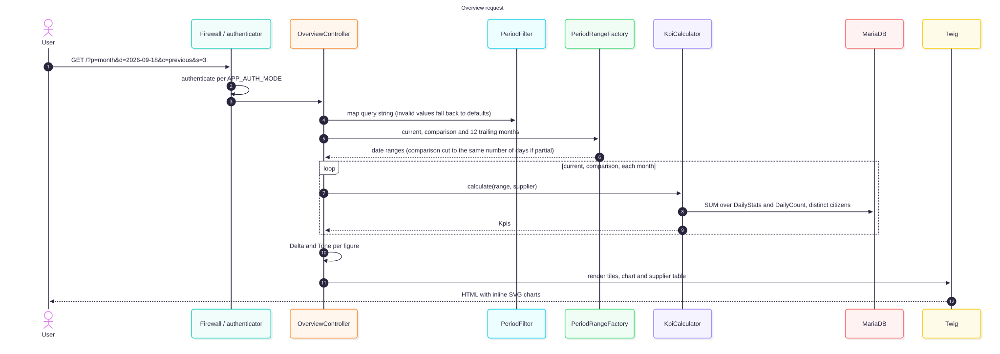

# Architecture

This document describes the architecture of Passenger Transport Performance for milestone 1:
username/password login, upload of driving data, manual entry of daily counts, and an overview
with eight key figures. See the [README](../README.md) for what the application does and
[the plan](plan.md) for how it is built.

The diagrams are Mermaid files in [`diagrams/`](diagrams/). Each image links to its source. Run
`task docs:diagrams` after changing a source; CI fails if a rendered SVG is out of date.

## Contents

- [Goals and constraints](#goals-and-constraints)
- [System context](#system-context)
- [Containers](#containers)
- [Components](#components)
- [Data model](#data-model)
- [Importing driving data](#importing-driving-data)
- [Calculating the figures](#calculating-the-figures)
- [Security](#security)
- [User interface](#user-interface)
- [Testing](#testing)
- [Deployment](#deployment)
- [Open decisions](#open-decisions)
- [Decision records](#decision-records)

## Goals and constraints

- **Correct figures first.** Every figure is calculated the same way for any period, from summed
  counts. A wrong number is the worst possible bug, so calculation code has the strictest tests.
- **No duplicates.** Re-importing data overwrites what was there before. The same data must never
  be counted twice.
- **Source-independent import.** The column layout of an extract is described in a mapping file,
  not in code, so another source can be added without code changes.
- **Minimal personal data.** No names, addresses or driver data are imported. How citizen
  identifiers are handled is an [open decision](#open-decisions).
- **Simple to run.** One Symfony application and one database. No queue workers, no separate
  frontend build, no client-side chart library.
- **Every route requires a role.** Access is denied by default.

## System context

**Users:**

- **Viewers** read the overview.
- **Editors** export extracts from the planning system and upload them, and enter the daily counts
  of mails, complaints and phone calls.
- **Administrators** manage users, suppliers, and which supplier drives each route.

**Later milestones:** the dashed systems feed the application directly, replacing manual entry and
password login.

## Containers

The application runs on the ITK Dev Docker setup (`symfony-8` template):

| Container | Role |
|---|---|
| Traefik | TLS termination and routing to the site |
| nginx | Serves static assets and passes PHP requests to phpfpm |
| phpfpm | The Symfony 8 application on PHP 8.4 |
| MariaDB | All application data |

Console commands (`app:user:*`, `app:driving-data:*`) run in the phpfpm container.

Uploads are processed synchronously within the request. A queue (Symfony Messenger) and a worker
are added only when file sizes or integrations need them.

## Components

| Namespace | Responsibility |
|---|---|
| `Controller` | Thin HTTP layer: checks the role, handles the form, calls a service, renders a template |
| `Form` | Hand-built form types for upload, daily counts and administration |
| `Security` | One authenticator per auth mode, and the role guards |
| `Import\DrivingData` | Reads an extract through a mapping and turns it into stored data and aggregates |
| `Report` | Period handling and the calculation of every figure |
| `Twig` | Formatting helpers and server-rendered components: tiles, sparklines, line charts, panels |
| `Command` | Console commands for users and imports |
| `Entity`, `Repository` | Doctrine entities and the aggregate queries |

**Rules:**

- **Logic lives in plain PHP classes.** All logic is in `Report` and `Import`, as plain classes with
  no framework dependencies where possible. Controllers, forms and commands only wire things
  together. This keeps most tests fast unit tests.
- **One import path.** The web upload and the console command use the same import services.

## Data model

**Terms:**

- **Route:** a vehicle schedule in the planning system, identified by its name in the extract. It
  is assigned to a supplier by an administrator. If no supplier is assigned, it counts as
  "Unknown".
- **Route run:** one chain of pickups and drop-offs on a route, from the first citizen getting in
  until the vehicle is empty again. A route can have several runs a day. Punctuality and solo
  routes are measured per run.
- **Trip:** one citizen's journey from pickup to drop-off.

| Entity | Purpose |
|---|---|
| `User` | Login account: username, roles, password hash |
| `Supplier` | A transport supplier |
| `Route` | A route from the extract and its supplier |
| `ImportBatch` | One upload: mapping, file name, who and when, the date range, row counts, rejection reasons |
| `StopRow` | One stop from the extract, keyed by mapping name and row key. See [open decisions](#open-decisions) |
| `RouteRun` | Derived: one route run with its last drop-off, delay, peak passengers and distances |
| `DailyStats` | Derived: the counters for one date and supplier that every driving figure is summed from |
| `DailyCount` | Manually entered mails, complaints and phone calls for one date |

**Derived tables are always rebuildable.** `RouteRun` and `DailyStats` are rebuilt from `StopRow`
for the dates an import touched, and for all dates when a route's supplier changes. They hold no
information that can't be recalculated.

## Importing driving data

### Import mappings

A mapping file, `config/import/driving_data/<MAPPING_NAME>.yaml`, describes one source's extract:

- the sheet and the header row
- the **row key**: one or more columns that identify a row
- for each application field: the source column, type, date format, value maps for codes, and
  whether it is required

`MappingLoader` validates the file with the Symfony Config component when the container is built,
so an invalid mapping stops the application from starting. It then produces an immutable
`Mapping` value object. `StopRowParser` reads the workbook only through `Mapping` and never
refers to column names itself. `app:driving-data:mapping:validate` checks a sample file against
a mapping before it is used.

### Pipeline

1. **Parse.** `StopRowParser` reads each row and converts the fields. Invalid rows are rejected
   with their row number and a reason. Field values are never written to messages or logs. The
   person id is pseudonymised before it leaves the parser.
2. **Upsert.** `StopRowUpserter` writes rows keyed on `(mapping_name, row_key)`, which is a unique
   index. An existing key is updated, and a new key is inserted. Duplicates are impossible at
   database level. It returns the counts and the set of affected dates.
3. **Build route runs.** `RouteBuilder` replaces `RouteRun` rows for the affected dates. It orders
   each route's stops by planned time and splits them into runs at the end-of-route flag.
4. **Aggregate.** `DailyStatsAggregator` replaces `DailyStats` rows for the affected dates, one
   per supplier.
5. **Clean up.** The uploaded file is deleted, and the `ImportBatch` is updated with the counts.

All steps for one upload run in one database transaction. A failed import leaves the data as it
was.

## Calculating the figures

**Filters:** `PeriodFilter` maps the query string (`p` period, `d` date, `c` comparison,
`s` supplier). Invalid values fall back to the defaults, so a link always works.

**Periods:** `PeriodRangeFactory` turns the filter into three sets of date ranges:

- the selected period
- the comparison period: the previous period, or the same period last year. If the selected
  period has not ended, the comparison is cut to the same number of days.
- the 12 trailing months for sparklines and the trend chart

**Calculation:** `KpiCalculator` runs one aggregate query per range and returns a `Kpis` value
object.

| Figure | Calculation |
|---|---|
| Empty running (%) | `SUM(empty_km) / SUM(driven_km)` |
| Trips | `SUM(trips)` |
| Citizens | Distinct citizens in the range (depends on [ADR 004](adr/004-personal-data-in-driving-data.md)) |
| Solo routes | `SUM(solo_runs)`, shown with `SUM(solo_runs) / SUM(route_runs)` |
| Punctuality (%) | `SUM(on_time) / SUM(last_drop_offs)` |
| Complaints | `SUM(complaints)`, shown with `SUM(complaints) / SUM(trips) × 1000` |
| Mails | `SUM(mails)` |
| Phone calls | `SUM(phone_calls)` |

**Rules:**

- Ratios are calculated from sums and never averaged from daily percentages.
- A zero denominator gives "no value" (shown as "–"), not zero.
- The supplier filter applies to `DailyStats`. `DailyCount` is office-wide.

**Delta and tone:** `Delta` gives the change from the comparison period, and whether it is better
or worse for that figure. `Tone` maps a value to ok, warn or danger using thresholds from one
config file.

## Security

**Authentication:** `APP_AUTH_MODE` selects the authenticator. There is one firewall, and each
authenticator's `supports()` checks the mode, so only one is ever active.

- **`password`**: a login form with CSRF protection, login rate limiting, remember-me and logout.
  Users are created with `app:user:create`.
- **`none`**: every request is signed in as a local user with `APP_NO_LOGIN_ROLES`. The
  application refuses to start in `prod` unless `APP_ALLOW_NO_LOGIN_IN_PROD=1`.
- **`oidc`**: a later milestone.

**Authorization:**

- Roles form a hierarchy: `ROLE_ADMIN` > `ROLE_EDITOR` > `ROLE_USER`.
- Every controller has a class-level `#[IsGranted]`.
- `access_control` denies everything to anonymous users except `/login` and assets.
- A test walks the router and fails if any application route has no `IsGranted`.

**Data protection:**

- Forms use CSRF tokens.
- Uploads are limited to `.xlsx` and a maximum size, and are deleted after processing.
- Rejection reasons and logs never contain field values from the extract.

## User interface

**Rendering:**

- Server-rendered Twig with AssetMapper. There is no Node build step.
- Styling comes from the itkaarhus design system, mapped in AssetMapper as `itkaarhus-ds`, plus
  the prototype's stylesheet ported to `assets/styles/app.css`.
- Charts are Twig components that render inline SVG on the server. Each chart includes a hidden
  data table for screen readers. No chart JavaScript is used.
- Help texts (**?**) use the native HTML `popover` attribute.

**Language:** the UI is in Danish. Texts live in `translations/messages+intl-icu.da.yaml`, and
`FormatExtension` formats numbers, percentages, percentage points, deltas and period labels.

**Filters:** all state is in the URL, so every view can be bookmarked and shared.

## Testing

The project is developed test first, with 100 % line coverage and mutation testing. See the
[plan](plan.md#development-approach-test-driven-100--coverage-mutation-testing) for the full rules.

| Layer | What | Tools |
|---|---|---|
| Unit | `Report`, `Import`, value objects, `FormatExtension` | PHPUnit |
| Integration | Repositories and aggregate queries, upsert, commands | `KernelTestCase`, MariaDB, `dama/doctrine-test-bundle` |
| Functional | Every route × role, forms, login, upload end to end, the overview | `WebTestCase` |

**Mutation testing (Infection):**

- `src/Report` and `src/Import` require a covered MSI of 100 %. The rest of the mutated code
  requires 80 %.
- Controllers, form types and Twig components are not mutated.
- Pull requests run it on changed lines. Release branches run it on the whole code base.

## Deployment

**Pipelines:** Woodpecker deploys with `itkdev/ansible-plugin`:

- a push to `release/*` or `hotfix/*` deploys to staging
- a GitHub release on `main` deploys to production

**Deploy steps:** each deploy updates the code and runs `composer install --no-dev`, the
Doctrine migrations and `cache:clear` in the server's phpfpm container.

**Configuration:** server configuration lives in `.env.local` on the server. Woodpecker secrets
hold the connection details.

**CI:** GitHub Actions runs coding standards, PHPStan, tests with the coverage gate, mutation
testing and the diagram check on every pull request.

## Open decisions

- **Personal data in driving data** ([ADR 004](adr/004-personal-data-in-driving-data.md), draft).
  - This decides whether `StopRow` and the pseudonymised person key are stored, kept for a
    correction window, or replaced by aggregates and distinct-count sketches.
  - The data model above shows the current working assumption (rows with a pseudonymised key).
  - It must be decided before the extract parser is built (task M1-10b).
- **Stable row key.** Is there a single stable row id column in the extract? It is configured in
  the mapping either way.

## Decision records

See [`adr/`](adr/README.md):

- [001: Stack](adr/001-stack.md)
- [002: Configurable authentication modes](adr/002-auth-modes.md)
- [003: Driving data import with mappings and overwrite by row key](adr/003-driving-data-import-mapping-and-overwrite.md)
- [004: Personal data in driving data](adr/004-personal-data-in-driving-data.md)
