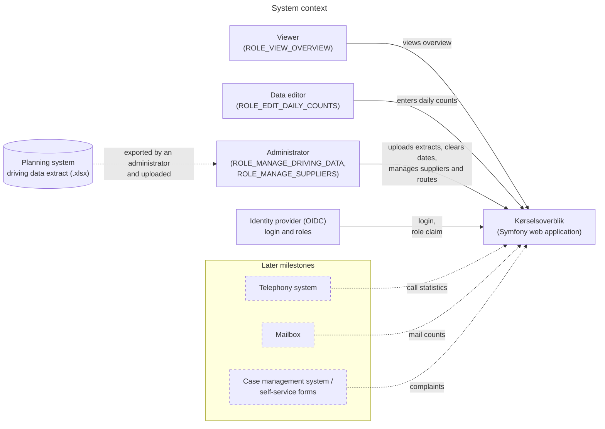
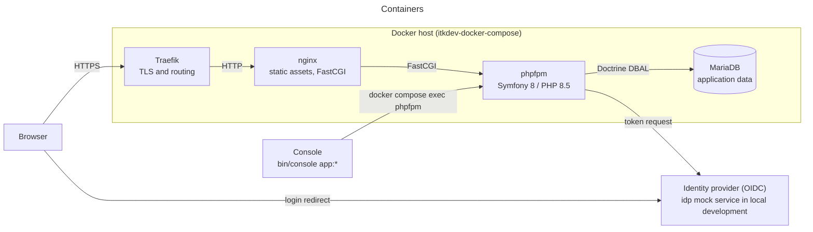
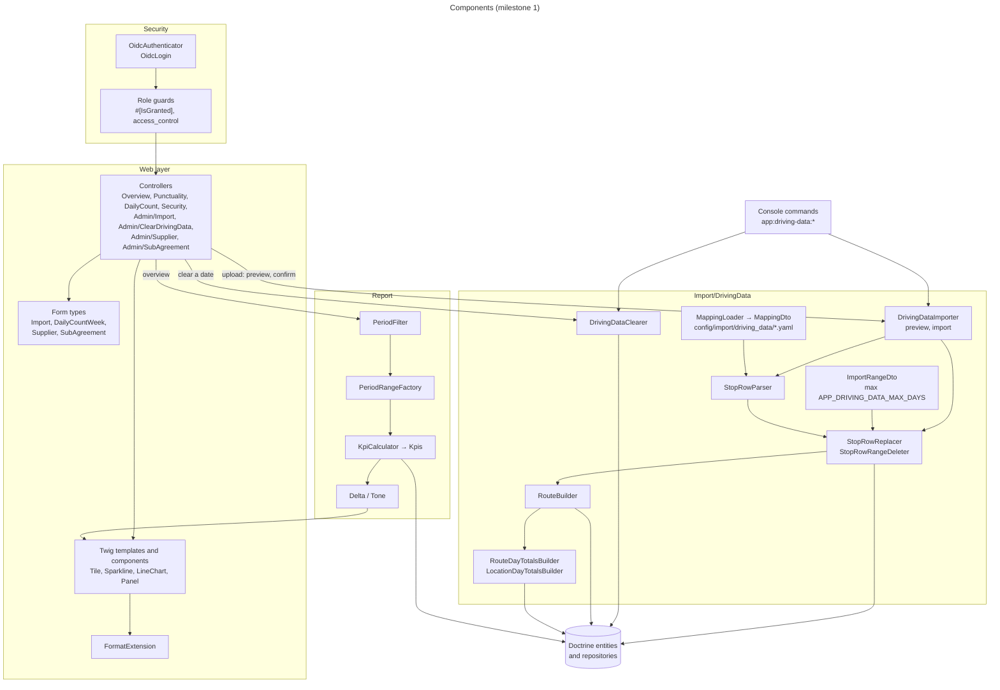
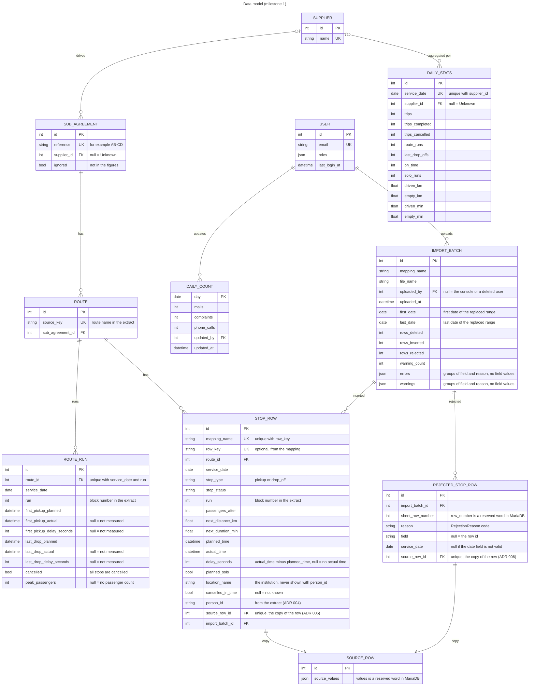
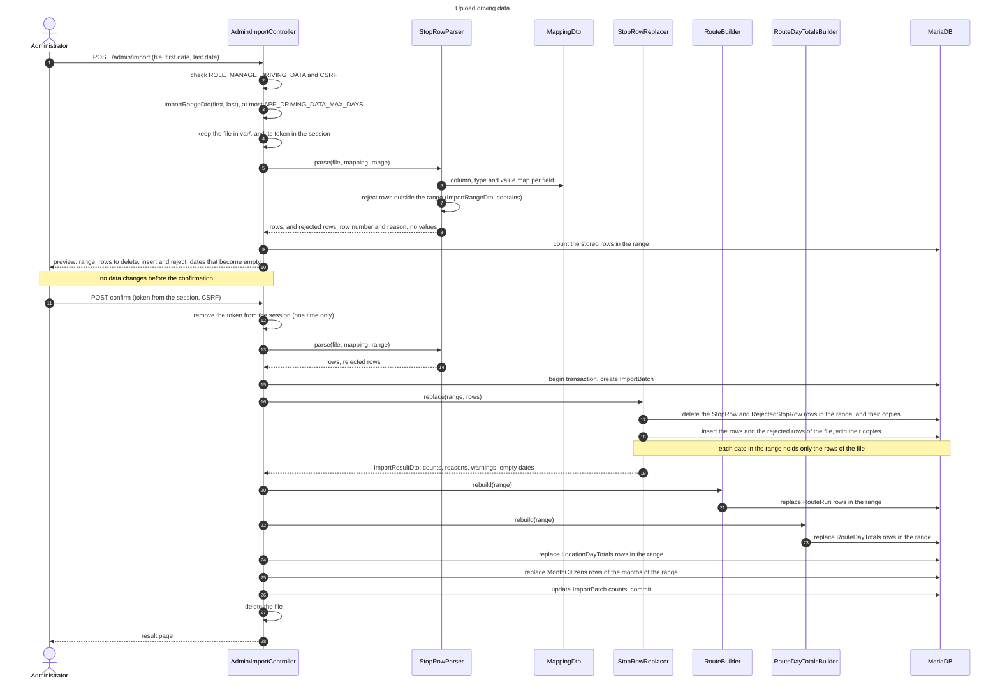
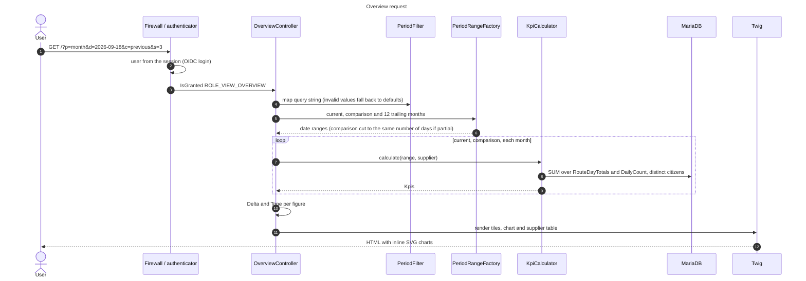
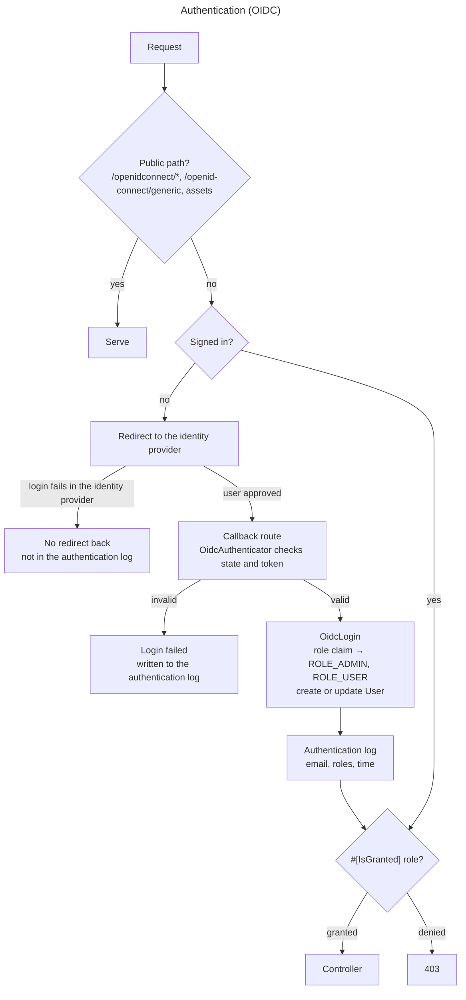

# Architecture

This document describes the architecture of Kørselsoverblik for milestone 1:
OIDC login, upload of driving data, manual entry of daily counts, and an overview
with eight key figures. See the [README](../README.md) for what the application does.

The diagrams are Mermaid code blocks in this document. GitHub renders them. Edit a block to change
its diagram.

## Contents

- [Goals and constraints](#goals-and-constraints)
- [System context](#system-context)
- [Containers](#containers)
- [Components](#components)
- [Data model](#data-model)
- [Importing driving data](#importing-driving-data)
- [Calculating the figures](#calculating-the-figures)
- [Security](#security)
- [User interface](#user-interface)
- [Testing](#testing)
- [Deployment](#deployment)
- [Open decisions](#open-decisions)
- [Decision records](#decision-records)

## Goals and constraints

- **Correct figures first.** Every figure is calculated the same way for any period, from summed
  counts. A wrong number is the worst possible bug, so calculation code has the strictest tests.
- **No duplicates.** Re-importing data replaces all stored data in the date range of the upload.
  The same data must never be counted twice, and rows that are not in a corrected file must not
  stay.
- **Configurable column layout.** A mapping file gives the column names, the code values and the
  formats of an extract, so a change of these needs no code change. A new field needs code (see
  [Import mappings](#import-mappings)).
- **Minimal personal data.** No names, addresses, free text or driver data are imported. The
  person id is kept only to count citizens. The decision is proposed, not accepted (see
  [open decisions](#open-decisions)).
- **Simple to run.** One Symfony application and one database. No queue workers, no separate
  frontend build, no client-side chart library.
- **Every route requires a role.** Access is denied by default.

## System context



**Users:**

- **Viewers** read the overview.
- **Data editors** enter the daily counts of mails, complaints and phone calls.
- **Administrators** export extracts from the planning system and upload them, clear the
  driving data for a date, and manage suppliers and which supplier drives each sub-agreement.
  The identity provider manages the users.

These are tasks, not roles. Each task has its own permission role (see
[Authorization](#security)), so one user can do one task or many.

**Identity provider:** users sign in through the identity provider (OIDC). It also gives the
roles of each user.

**Later milestones:** the dashed systems feed the application directly, replacing manual entry.

## Containers



The application runs on the ITK Dev Docker setup (`symfony-8` template):

| Container | Role |
| --- | --- |
| Traefik | TLS termination and routing to the site |
| nginx | Serves static assets and passes PHP requests to phpfpm |
| phpfpm | The Symfony 8 application on PHP 8.5 |
| MariaDB | All application data |
| idp | Local development only: an OIDC mock service (`ghcr.io/geigerzaehler/oidc-provider-mock`) with test users |

Console commands (`app:driving-data:*`) run in the phpfpm container.

Uploads are processed synchronously within the request. A queue (Symfony Messenger) and a worker
are added only when file sizes or integrations need them.

## Components



| Namespace | Responsibility |
| --- | --- |
| `Controller` | Thin HTTP layer: checks the role, handles the form, calls a service, renders a template |
| `Form` | Hand-built form types for upload, daily counts and administration |
| `Security` | The OIDC authenticator, the mapping from the role claim to roles, and the role guards |
| `Import\DrivingData` | Reads an extract through a mapping and turns it into stored data and aggregates |
| `Report` | Period handling and the calculation of every figure |
| `Twig` | Formatting helpers and server-rendered components: tiles, panels, help texts, sparklines, line charts, column charts, distribution bars |
| `Chart` | The geometry of the charts in plain PHP: scales, paths, bars and parts. The templates only draw it |
| `Command` | Console commands for imports and clearing |
| `Entity`, `Repository` | Doctrine entities and the aggregate queries |

**Rules:**

- **Logic lives in plain PHP classes.** All logic is in `Report` and `Import`, as plain classes with
  no framework dependencies where possible. Controllers, forms and commands only wire things
  together. This keeps most tests fast unit tests.
- **One import path.** The web upload and the console command use the same import services.

## Data model



**Terms:**

- **Route (vognløb):** a vehicle schedule in the planning system, identified by its name in the
  extract, for example `AB-CD-01`.
- **Sub-agreement (delaftale):** the part of a route name before the last `-` or `_` and the
  digits after it, for example `AB-CD` in `AB-CD-01`, or `TEST` in `TEST_01`. A name without such
  an end is a sub-agreement as a whole. The application does not split the sub-agreement further,
  because not all names have the same format. A reference can itself end in a number, for example
  `TEST-2` from `TEST-2-01`. Thus the form does not apply the route name rule to a typed
  reference. An administrator gives each sub-agreement one supplier. The supplier applies to all
  dates. The routes of a sub-agreement with no supplier count as "Unknown". An administrator can
  ignore a sub-agreement whose routes are not route runs, for example "Turbestilling". The
  figures leave out its routes.
- **Route run:** one chain of pickups and drop-offs on a route, from the first citizen getting in
  until the vehicle is empty again. A route can have several runs a day. The extract gives each
  run a block number. Punctuality and solo routes are measured per run.
- **Trip:** one citizen's journey from pickup to drop-off.

| Entity | Purpose |
| --- | --- |
| `User` | An account from the identity provider: email (the `upn` claim), roles from the last login, time of the last login. No password |
| `Supplier` | A transport supplier |
| `SubAgreement` | A sub-agreement, with the supplier that drives its routes (empty = "Unknown"), and a flag that leaves its routes out of the figures. `SubAgreementReference::fromRouteName()` finds it from a route name |
| `Route` | A route from the extract, with its sub-agreement. The import creates it |
| `ImportBatch` | One upload: mapping, file name, who and when, the replaced date range, row counts, and the rejection reasons and warnings as groups of field and reason |
| `StopRow` | One stop from the extract, with an optional row key from the mapping and the copy of the row. See [open decisions](#open-decisions) |
| `RejectedStopRow` | A rejected row in the range of its upload, with the row number, the reason and the copy of the row. A later read through a corrected mapping can import it |
| `SourceRow` | The copy of one row of the extract, for one `StopRow` or one `RejectedStopRow`. See [Keep a copy of each imported row](#keep-a-copy-of-each-imported-row) |
| `RouteRun` | Derived: one route run with its first pickup and its last drop-off, each with the planned time, the actual time and the delay, and the peak passengers. A later feature adds the distances and the durations. See [open decisions](#open-decisions) |
| `RouteDayTotals` | Derived: the counters for one route and date that the driving figures are summed from, and the tolerance of the build. It has all routes, also the routes of an ignored sub-agreement. It has no citizens and no person ids |
| `LocationDayTotals` | Derived: the measured pickups and drop-offs, and those of them that are on time, for one location, route and date, and the tolerance of the build. It has all routes, also the routes of an ignored sub-agreement. It has no person ids |
| `MonthCitizens` | Derived: the number of citizens in one calendar month, for all suppliers (no supplier) or for one supplier. It has no person ids |
| `DailyCount` | Manually entered mails, complaints and phone calls for one date |

**A sub-agreement has one supplier.** The supplier has no dates. A change of the supplier
applies to all dates, also to the dates before the change. The import creates a sub-agreement
with no supplier, so the database accepts a sub-agreement with no supplier. The foreign key has
no `ON DELETE`, so the database blocks the delete of a supplier with sub-agreements.

**An ignored sub-agreement is left out in the queries, not in the import.** The import stores
its stop rows and builds its route runs. Each query that counts driving data for the figures
calls `CountedRouteFilter::apply()`. The filter reads the ids of the routes of the sub-agreements
that are not ignored, and limits the query with `IN (:ids)`. Thus a change of the flag needs no
new import.

The filter does not join the route and the sub-agreement. With a join, MariaDB starts at the few
sub-agreements and reads the rows of each route for all dates. Thus each query reads all the
history, and gets slower when the data grows. With a list of ids, MariaDB reads only the dates of
the range. The index `stop_row (route_id, service_date)` gives the same result for a list of a
few routes.

Each figure query reads the list again. The lookup takes less than 1 ms, and a list in memory for
the request can become old when the flag changes. With all suppliers, the list has nearly all
routes. This is sufficient for some hundreds of routes. Check it again if the routes become
thousands.

**Derived tables are always rebuildable.** `RouteRun`, `RouteDayTotals` and `LocationDayTotals`
are rebuilt from `StopRow` for the dates an import touched, and `MonthCitizens` for the full
months of those dates. The derived tables hold no information that can't be recalculated.

- A change of the supplier or the ignored flag of a sub-agreement needs no rebuild of
  `RouteDayTotals` and `LocationDayTotals`, because the queries apply them with
  `CountedRouteFilter`.
- The counts on time of `RouteDayTotals` and `LocationDayTotals` depend on
  `APP_PUNCTUALITY_TOLERANCE_MINUTES`. Each row stores the tolerance of its build. A sum fails
  with `OtherToleranceException` if a row has another tolerance. Then run
  `app:driving-data:rebuild-totals --no-debug`. It builds all dates of the three derived tables
  of the figures again in one transaction.
- `LocationDayTotals` keeps the location name of the stop rows, because the figures group by it.
  It has no person id, so a location is only a group of stops.
- The citizens are distinct person ids, so the citizens of two days or two months cannot be
  added. `MonthCitizens` holds the count of each calendar month, for all suppliers and for each
  supplier, with no person ids. A period that is not a calendar month is counted on `StopRow`.
  The index `stop_row (service_date, stop_type, stop_status, route_id, person_id)` has all the
  columns of that query, so MariaDB does not read the rows. The index starts with the date, so it
  also serves the queries of a date range. Thus `stop_row` has no index on the date alone.
- The counts of `MonthCitizens` depend on the sub-agreements. Thus an edit of a sub-agreement
  builds all months again for the scopes that it changes, in the same transaction as the save.
  `MonthCitizensBuilder::rebuildAfterSubAgreementChange()` finds the scopes. The ignored flag
  changes the count of all suppliers and of the supplier of the sub-agreement. The supplier
  changes the counts of the old and the new supplier. With one year of data, the save then takes
  approximately 1.5 to 2.5 seconds, and the time grows with the history. A new sub-agreement has
  no routes until an import, so it builds nothing.
- Each code path that changes the supplier or the ignored flag of a sub-agreement must build the
  counts of `MonthCitizens` again. Otherwise a month on the overview shows an old count, with no
  error. Today these paths are the edit of a sub-agreement and `app:fixtures:suppliers`.
- `MonthCitizensBuilder::rebuildAll()` deletes all rows of a scope, and writes only the months
  that have stop rows. When the retention job of ADR 004 deletes old stop rows, a later rebuild
  thus deletes the counts of those months. Decide this before the job is built.
- `DayTotalsDto::fromRow()` fails if a query row has no value for a counter that the query must
  give. Thus a wrong alias in a query does not give zeros with no error.
- `OtherToleranceListener` shows `OtherToleranceException` as a page with the status 503. The
  page names the command, so that the admin does not have to read the log first.

## Importing driving data



### Import mappings

A mapping file, `config/import/driving_data/<MAPPING_NAME>.yaml`, describes one source's extract:

- the sheet and the header row
- an optional **row key**: one or more source columns that identify a row. It finds duplicate
  rows in one file
- optional **kept columns**: the other columns that the copy of a row keeps (see
  [Keep a copy of each imported row](#keep-a-copy-of-each-imported-row))
- optional **excluded columns**: the columns that the mapping leaves out on purpose, for example
  the personal data
- for each application field: the source column, type, date format, value maps for codes, and
  whether it is required

`MappingLoader` validates the file with the Symfony Config component when the container is built,
so an invalid mapping stops the application from starting. The parser removes the spaces at the
start and the end of the header names, so the validation rejects a column name with such a space.
An excluded column cannot also be a field column, a row id column or a kept column. The loader
then produces an immutable `MappingDto` value object. `StopRowParser` reads the workbook only
through `MappingDto` and never refers to column names itself.

`app:driving-data:mapping:validate` checks a sample file against a mapping before it is used. It
uses the same parser without a date range, and `ExtractSummaryDto` counts the result. The output
hides the person id and never shows a value of a rejected row or a warning. It also hides the row
key when a row id column is the person id column. `ExtractColumnsDto` compares the header with the
mapping. The output names the kept columns and the excluded columns that are not in the file, and
the columns that the mapping does not read. An excluded column is a decision, so it is never a
column that is not read. The fixture writer writes the excluded columns with no values, as the
reference extract has them.

**What a mapping can change:** the column names, the code values and the formats of the fixed
application fields. Each application field must have one source column. These changes need code:

- a field that the extract does not have
- a field that is made from more than one column, or a column that holds more than one field
- a new application field

### Keep a copy of each imported row

An upload deletes the extract after the import, so a column that the import does not keep is lost
for all the uploaded dates. Thus the parser keeps a copy of each row
([ADR 006](adr/006-keep-a-copy-of-each-imported-row.md), proposed):

- The copy holds the field columns, the row id columns and the kept columns of the mapping, keyed
  by the column name. The command `app:driving-data:read-copies` reads the copies again through a
  changed mapping, with no new upload (see [Read the stored copies again](#read-the-stored-copies-again)).
- `SourceCells` makes the copy, and the cells again from a copy. The copy keeps the type of each
  cell: text, numbers and booleans are JSON values, and a duration, a date and time and an Excel
  error are objects with one key, for example `{"duration": "P0DT25H10M0S"}`. An empty cell is
  left out.
- A formula cell gives its computed value, in the parser (`CellConverter`) and in the copy. The
  formula is not kept. When the result of the formula is an error, the reader gives no computed
  value, so the cell is empty.
- A rejected row also has a copy, and its service date if the date field is valid. A row outside
  the range of the upload has no copy, because the upload for its date imports it.
- In an optional field, a value that the parser cannot read gives an empty value and a
  `FieldWarningDto`. The row is imported, and the copy keeps the value.
- The copy never holds the personal data of the extract. A column is kept only when the mapping
  names it, so a new column is not kept until a person adds it. The `default` mapping names the
  personal columns in `exclude_columns`, and the validation stops a column that is both kept and
  excluded.
- The copy has the values on purpose. It never goes to a log, a message or the output of the
  validate command.
- The copy is a `SourceRow` in its own table. `StopRow` and `RejectedStopRow` own the one-to-one
  relation, so Doctrine gives a lazy object and does not read the copy with the row. `SourceRow`
  has no relation back, because Doctrine reads an inverse one-to-one side at once.
- A DQL delete does not cascade. Thus `StopRowRangeDeleter` reads the ids of the copies of the
  rows in the range first. Then it deletes the rows, and calls
  `SourceRowRepository::deleteByIds()`. The delete of the copies uses the primary key, so it does
  not read the copies of other dates.
- The ids come from the snapshot of the transaction, but the deletes see the latest committed rows.
  Thus two imports of the same dates that overlap can leave copies with no row. The command
  `app:driving-data:delete-orphan-copies` deletes them with `SourceRowRepository::deleteOrphans()`.
  A cron job runs it each night. The import does not call it, because it reads all copies.

### Read the stored copies again

After go-live an upload deletes the file, so the copies are the only source of the dates that
were imported before. `app:driving-data:read-copies <FIRST_DATE> <LAST_DATE>` reads the copies of
a range again through the current mapping (#61). Use it after a new field from a kept column, a
changed rule of the mapping, or a mapping error that rejected rows.

- `StopRowParser::parseCopies()` reads copies with the same rules as the rows of a file. It makes
  a row from each copy, with the columns of the copy and the columns of the mapping as the header.
  A column of the mapping that is not in a copy is an empty cell.
- The new copy of a row has all the columns of the old copy, also a column that the mapping no
  longer keeps. Thus a read loses no data.
- `StoredCopyReader` works through the range one date at a time, as an import of one day. The
  replacement deletes the copies of the date, so the reader reads them first. The copies of one
  day fit in the memory, and a range of any length does not. Each date is one transaction, with
  its own batch (`StoredCopyReader::FILE_NAME`), and builds the route runs, the totals and the
  citizens of its month again.
- A date with no stored rows is not changed, so the read does not empty a date.
- The read reads the same rejected rows that the replacement of the date deletes
  (`RejectedStopRowRepository::copiesInRange()`): the rows of the date, and the rows with no date
  of a batch of that date only. A rejected row with no date of a larger batch belongs to no single
  date, so the read neither reads nor deletes it.
- Each row keeps the number of its row in the file. `StopRow` stores the number since #61. A stop
  row that was imported before has no number, so the read gives it its place on the date.
- The rows get the name of the mapping of the read, also the rows that another mapping imported.
- The read makes the preview first, and changes no data. The preview reads all copies of the
  range through the mapping, and collects the columns of the copies on the way. The read does not
  start if the preview finds one of these problems:
  - no copy of the range has a column of a required field or of the row id, as a file with a
    missing column. A missing column of an optional field gives no value, and a warning.
  - a copy gives another date than the date of its row. The replacement of one date would lose
    that row.
  - a date has stop rows, but its copies give none. A date with only rejected rows can give no
    stop rows.
  - a copy has a value of an unknown type.
- If a date fails during the read, for example with a row id that is stored on another date, that
  date keeps its rows, and the dates before it are read again. After the exception, Doctrine has
  closed the entity manager.
- The audit log records each read with the range, the mapping and the counts of the dates that are
  read, also when a date fails. Then the record is a warning with the failed date.

### The reference extract

A reference extract from the planning system gives the layout for the `default` mapping. The
extract is not in Git, and the docs contain no cell values from it. Counts of rows are
permitted, for example "7 of 80 runs".

**Layout:**

- One sheet. Row 1 is a title, row 2 is empty, and row 3 has the column headers.
- One row for each stop. Each trip has a pickup row and a drop-off row.
- The extract holds one service day. The date is in its own column, and the times have no date.
- The columns with names, addresses and places are empty in the reference extract.

**Columns in the `default` mapping:**

| Field | Column | Type in the extract | Note |
| --- | --- | --- | --- |
| row key | `RouteStopID` | text | Unique for each row. |
| `route` | `RouteName` | text | To be confirmed: see "Route column" in [open decisions](#open-decisions). |
| `person_id` | `PersonID` | text | [ADR 004](adr/004-personal-data-in-driving-data.md) |
| `service_date` | `Date` | text, `Y-m-d` | The service day of all the times in the row. |
| `run` | `blocknumber` | integer | The route run. A route run is the route, the date and the run. |
| `stop_type` | `StopType` | text code | Two codes: pickup and drop-off. |
| `stop_status` | `Status` | text code | Three codes: completed, cancelled, and no registration (`pending`). |
| `passengers_after` | `passengersaftercancel` | integer | The passengers after the stop, when the cancellations are removed. |
| `next_distance_km` | `ToNextDistance` | decimal | Kilometres. Can be empty. |
| `next_duration_min` | `ToNextDuration` | decimal | Minutes. Can be empty when the distance is not. |
| `planned_time` | `PlannedDeparture` | Excel time, `[hh]:mm:ss` | A wall-clock time on `service_date`. Can be 24:00 or more (see [Times](#times)). |
| `actual_time` | `StatusUpdateTime` | Excel date and time | Empty when the stop has no registration. |
| `planned_solo` | `kørselstype` | text code | Two codes: solo and shared. |
| `location_name` | `Placename` | text | The institution of a trip. Empty in the reference extract. Never shown with a person id, or written to a log or to the output of a command. |
| `cancelled_in_time` | `RettidigAflysningsvarsel` | text code | "yes" when the trip is cancelled on an earlier date, or more than 60 minutes before the planned arrival. "no" in all other rows, also when the stop is not cancelled. Optional. See "Cancellation notice" in [open decisions](#open-decisions). |

**Why the planned time comes from `PlannedDeparture`:** the planning system has a planned arrival
(`PlannedArrival`) and a planned departure (`PlannedDeparture`) for each stop. The current report
exports only the departure. The departure is some minutes after the arrival. The transport office
measures punctuality against the planned departure, because the driver registers the stop when
the citizen is in or out of the car.
`StatusUpdateTime` is that registration.

**Why the run comes from `blocknumber`:** the extract also has a column for the start and a column
for the end of a block. In the reference extract, one run has a start but no end. A split on the
end flag joins that run with the next run. The block number gives each run directly.

**Columns in the copy only:** the `default` mapping keeps the other columns of the current
report in the copy of a row, but not the personal data. A column that the report does not export
is not in the mapping. If a feature needs such a column, the transport office adds it to the
report first. The kept columns are:

- the ids of trips, addresses, locations and places
- the cancellation columns: the cancellation id, the time of the cancellation
  (`aflysningstidspunkt`, a date and a time), and the notice in minutes (`aflysningsvarsel`). The
  notice uses only the time of day of the cancellation, so it is not correct for a cancellation on
  an earlier day (see "Cancellation notice" in [open decisions](#open-decisions))
- the channel (`afbestillingskanal`), the type (`aflysningstype`) and the category
  (`aflysningskategori`) of a cancellation. They are empty when the stop is not cancelled. The type
  follows from the channel. The list of categories is not fixed, and the institution portal often
  gives no category
- `chauffør`, the id of the driver of the route in the planning system. It is personal data about
  the driver ([ADR 006](adr/006-keep-a-copy-of-each-imported-row.md)). Never show it, or write it to
  a log or to the output of a command. The mapping names it in `hidden_columns`, so the detail
  pages of a row show `(skjult)` in place of the value
- `prisprminut`, the price per minute, for the cost of empty running
- `passengers`, the passengers after the stop before the cancellations are removed
- `blokstart` and `blokslut`
- `vogn`, `vogntype`, `chaufførtype` and `operatør`, for the number of vehicles. A vehicle
  profile (`vogntype` is `Profile`) is on many routes at the same time, so its `vogn` is not one
  vehicle (see "Number of vehicles" in [open decisions](#open-decisions))

No feature uses these columns yet. A later feature can add typed fields for them, and fill the
fields from the copies.

**Columns that are never kept:** the personal data. `PersonName`, `Adresse`, `Post-nr` and `By`
identify a citizen. `Labels` and `Comment` can hold the needs of a citizen or free text, and that
can be health data ([ADR 004](adr/004-personal-data-in-driving-data.md)).

### Times

A `time` field is an Excel cell with a duration format, such as `[hh]:mm:ss`. OpenSpout gives
such a cell as a `DateInterval`. A cell with an ordinary time format, such as `hh:mm`, is
rejected. The time is a wall-clock time on the `service_date` of the row. A time of 24:00 or
more is on the next day. For example, 25:10 is 01:10 on the day after `service_date`.

The application supports one time zone only
([ADR 005](adr/005-dates-and-times-in-one-time-zone.md)). The times in the extract are
wall-clock times in the PHP default time zone (`date.timezone` in `php.ini`, `Europe/Copenhagen`).
MariaDB must use the same time zone. The import stores the times with no conversion:

- `CellConverter` reads a date and time as a wall-clock time. It uses UTC for the PHP object,
  because UTC has no change to summer time.
- `StopRowDto` reads the wall-clock time in the PHP default time zone.
- `service_date` and the dates of `ImportRangeDto` are calendar dates at 00:00 in the PHP
  default time zone.
- A time that does not exist moves one hour later. For example, 02:30 on the night of the change
  to summer time is read as 03:30 summer time.
- A time that occurs two times, on the night of the change to winter time, is read as winter
  time (the second one).
- Calculate a delay from `getTimestamp()`. A delay across a change to or from summer time is
  then correct.
- Store a delay in seconds. A figure compares it with a tolerance in minutes × 60, so no rounding
  rule is necessary. `StopRowDto` calculates `delay_seconds` at the import.

The browser shows the times as they are stored.

### Date range

The user enters the first and the last date of the export, together with the file.
`ImportRangeDto` holds the two dates. The import replaces exactly this range
([ADR 003](adr/003-driving-data-import-mapping-and-overwrite.md)):

- A date in the range with no rows in the file becomes empty. This includes the first and the
  last date.
- A row with a date outside the range is rejected. A wrong date in one row cannot change other
  dates. `ImportRangeDto::contains()` is the only check. `StopRowParser` calls it for each row,
  so the preview and the import reject the same rows.
- The range can be at most `APP_DRIVING_DATA_MAX_DAYS` days (default 31). A longer range is
  rejected, and no data changes.

### Pipeline

`DrivingDataImporter` is the one service for the upload page and the import command.
`preview()` does step 1, and `import()` does steps 3 to 7 in one transaction
(`EntityManager::wrapInTransaction()`). The replacement assumes that each extract holds whole
days and all routes of a day (questions 3 and 4 in [open decisions](#open-decisions)).

`app:driving-data:import` shows the same preview in the console, and asks for a confirmation
with "no" as the default. It refuses a file with no stop rows in the range, because the import
would only delete data. The batch has no user. The command does not delete the file.

1. **Preview.** The upload keeps the file in `var/` with a random name, and keeps its token in
   the session. The parser reads the file, and the page shows the range, the rows to delete,
   insert and reject, and the dates that become empty. No data changes.
2. **Confirm.** The user confirms. The controller removes the token from the session before the
   import, so the token works one time only. A second confirmation, for example after a double
   click, finds no token. It shows a message and imports nothing. The steps below parse the file
   again and import it. If the user cancels, the file is deleted.
3. **Parse.** Before the first row, `ExtractInspector` checks the whole file against the
   `ExtractLimitsDto` limits. See "Data protection" in [Security](#security). Then
   `StopRowParser` reads each row and converts the fields. Invalid rows are rejected
   with their row number and a reason. A row with a date that `ImportRangeDto::contains()` does
   not accept is also rejected. A row key that occurs again in the file is rejected after the
   first stop row with the key, with the reason `duplicate_row_id`. The preview, the validate
   command and the import then reject the same rows. A bad value in an optional field gives a
   warning, not a rejection.
   The reason and the warning are `RejectionReason` codes, so field values are never written to
   messages or logs. The person id is kept as it is in the extract
   ([ADR 004](adr/004-personal-data-in-driving-data.md), proposed). Each row, and each rejected
   row in the range, has a copy of its columns (see
   [Keep a copy of each imported row](#keep-a-copy-of-each-imported-row)).
4. **Replace.** `StopRowReplacer` calls `StopRowRangeDeleter`, which deletes all `StopRow` rows in
   the range, from all mappings. Then the replacer inserts the parsed rows. It does not check the
   range or the row keys again. Rows that are not in the new file are removed, and two uploads can
   never count the same date twice. A unique index on `(mapping_name, row_key)` makes sure that a
   row key is stored one time.
   - The deleter also deletes the `RejectedStopRow` rows with a date in the range, and the
     rejected rows with no date of the earlier batches whose whole range is in the new range. The
     condition is in `RejectedStopRowRepository`. Then the replacer stores the rejected rows of the
     file with their copies. A row outside the range is not stored, because the upload for its
     date imports it.
   - After the deletes of the rows, the deleter deletes the `SourceRow` copies of the deleted rows.
   - The replacer finds each route by its name, or creates it. A new route finds or creates its
     sub-agreement with `SubAgreementReference`. A new sub-agreement has no supplier, so its
     routes count as "Unknown". MariaDB compares text with no regard to case, so two route names
     that differ only in case are one route.
   - It saves the rows in groups of 500, and then the entity manager forgets them, so the memory
     use does not grow with the file.
   - It returns an `ImportResultDto`: the deleted and inserted counts, the rejected rows and the
     warnings as `RejectionGroups` (field, reason, count and the first 10 row numbers), and the
     dates of the range with no rows.
   - A row key that is stored on a date outside the range breaks the unique index, and the whole
     import fails with no change. `DrivingDataImporter` then throws `RowIdConflictException`, with
     no value from the extract. With whole days and unique row ids, this does not occur.
5. **Build route runs.** `RouteBuilder` replaces `RouteRun` rows for the range.
   - It reads the stop rows of one date at a time, so that the memory use does not grow with the
     range. It groups the stops by route and run (the block number in the extract).
   - `RouteRunCalculator` finds the first pickup and the last drop-off of each run. The first
     pickup is the pickup with the earliest planned time that is not cancelled. The last drop-off
     is the drop-off with the latest planned time that is not cancelled.
   - A stop is measured when its status is `completed` and it has an actual time. For a stop that
     is not measured, the run keeps the planned time, and the actual time and the delay are null.
   - A run is cancelled when all its stops are cancelled.
   - The peak passengers are the highest `passengers_after` of the stops that are not cancelled.
     A cancelled stop can have a count that includes the cancelled citizen, so it does not count.
     A pending stop counts, because it is often a driven stop with no registration. Thus the
     peak of the current month partly shows the plan. A run with no count has no peak.
   - It saves the runs in groups of 500, as the replacer does.
6. **Aggregate.** `RouteDayTotalsBuilder` replaces `RouteDayTotals` rows for the range, one per
   route and date.
   - Two grouped queries give the counters: `StopRowRepository::countDayTotals()` for the
     measured stops and the trips, and `RouteRunRepository::countDayTotals()` for the measured
     runs, the delay bands and the solo runs. They have the rules of the figures. They count all
     routes, so they do not use `CountedRouteFilter`.
   - It saves the rows in groups of 500, as the replacer does.
   - `LocationDayTotalsBuilder` then replaces the `LocationDayTotals` rows for the range, one per
     location, route and date. `StopRowRepository::countLocationDayTotals()` counts the
     completed pickups and drop-offs with a delay and a location name. It also counts all routes.
   - `MonthCitizensBuilder` then replaces the `MonthCitizens` rows of the full months of the
     range: from the first day of the month of the first date to the last day of the month of the
     last date. It counts each month with `StopRowRepository::countCitizensByMonth()`, for all
     suppliers and for each supplier.
7. **Clean up.** The uploaded file is deleted, and the `ImportBatch` is updated with the counts,
   the rejection reasons and the warnings (`ImportBatch::complete()`). They never have a field
   value.

Steps 3 to 7 run in one database transaction. A failed import leaves the data as it was.

**Unconfirmed files:** `app:driving-data:purge-uploads` deletes the upload files that are older
than one hour. A cron job on the server runs it every 15 minutes, and each new upload also runs
it. A confirmation after the purge shows that the upload has expired, and imports nothing.

**The upload page** (`Admin\ImportController`, `ROLE_MANAGE_DRIVING_DATA`) uses Post/Redirect/Get,
so that a reload never uploads or imports again:

1. `POST /admin/import`: `ImportType` checks the file (`.xlsx`, `APP_DRIVING_DATA_MAX_FILE_SIZE`)
   and the date range (`ValidImportRange`). `UploadStore` saves the file with a random name in
   `var/uploads/<APP_ENV>/driving_data/`, and keeps a `PendingUploadDto` in the session under a
   random token. Each environment has its own folder, so that the tests do not delete the uploads
   of dev. The page redirects to the preview.
2. `GET /admin/import/preview/{token}`: the preview. A file with no stop rows in the range has no
   confirm button. `DrivingDataImporter::import()` also refuses such a file with
   `NoStopRowsException`, and rolls back the delete of the range. Thus a direct POST to the
   confirmation, and the import command, cannot only delete data.
3. `POST /admin/import/preview/{token}/confirm` (CSRF): `UploadStore::take()` removes the upload
   from the session, the import runs, and the page redirects to the result.
4. `GET /admin/import/{id}`: the result, from the saved `ImportBatch`.

`UploadStore::take()` makes the file new, so that the purge does not delete it during the
import. `find()` forgets an upload whose file is gone.

An unknown token, a token of another session and a deleted file give "Uploaden er udløbet". An
error deletes the file, logs a warning with no value, and shows the problem in Danish. Each
`InvalidExtractException` has an `ExtractProblem` code for the translation. The English message
stays for the command and the logs. After a failed import, Doctrine has closed the entity
manager, so the controller resets it.

**The bulk upload** (`Admin\BulkImportController`, `ROLE_MANAGE_DRIVING_DATA`) takes many files.
UX Dropzone (`BulkImportType`, `multiple`) takes the drop. The form is not submitted. The
`bulk-upload` Stimulus controller sends each file in its own request, one request at a time, so
that the request limit applies to each file:

1. `POST /admin/import/bulk/check` (CSRF in the `X-CSRF-Token` header): the file is checked with
   the constraint of `ImportType`. `DrivingDataImporter::rangeAndPreview()` parses the file once.
   It reads the first and the last date with stop rows, and counts the rows of that range. The
   range has the same limit as a typed range. `UploadStore` keeps the file under a token.

The parse of an xlsx file in a request needs memory. With enough memory, OpenSpout keeps the shared
strings in memory, which is much faster than its file cache. `docker-compose.server.override.yml`
gives PHP-FPM 256M and 60 seconds on the servers, the same memory as dev.
2. `POST /admin/import/bulk/{token}` (CSRF): `UploadStore::take()`, and the same import as the
   single upload, with its own `ImportBatch`.

Each response is the HTML of the row of the file (`_bulk_row.html.twig`), with the status 200 or
422. The controller puts the row in the list. Thus the dates, the numbers and the errors use the
same Twig macros and translations as the single upload. `UploadFailure` gives the Danish message
of a failure for both controllers. The import button imports the checked rows in the order of the
list. A failed file does not stop the others.

**Whole days and the date range:** a file that holds only part of a day removes the other rows of
that day. A range that is longer than the export empties the extra dates. Users must upload whole
days and enter the range of the export. The preview lists the dates that become empty.

**No rollback:** an `ImportBatch` cannot be undone. To correct a wrong upload, upload the correct
file for the same range, or clear the dates.

### Clearing driving data

The driving data page (`Admin\DrivingDataController::index`, the tab "Kørselsdata" of the upload)
lists the dates with stop rows or rejected rows, one month at a time (`?month=YYYY-MM`). A month
that is not valid or that is after the current month gives the current month. The month links
stop at the current month and at the month of the first `ImportBatch`. A clear keeps the batches,
so no driving data is before that month. `UploadedDates` reads each list in six queries: the stop
rows, the stop rows of an ignored sub-agreement (two queries), the route runs and the rejected rows
of each date, and the batches that overlap the month. Each date shows the counts and the last
upload (file name, who, when). The last upload is the newest batch whose range has the date,
because an import replaces all dates of its range. A batch with no user shows "konsol": a console
upload, or an upload of a deleted user.

Users with `ROLE_MANAGE_DRIVING_DATA` can delete the driving data for a date, for example after a
wrong upload.

1. The user selects **Ryd** for a date. A native popover shows the counts and the form, so no
   script is necessary.
2. The user confirms. The form is a POST with a CSRF token for the date.
3. `DrivingDataClearer` runs these steps in one transaction. The counts come from the deletes, so
   they are exact also when another change runs at the same time.
   - `StopRowRangeDeleter` deletes the `StopRow` and `RejectedStopRow` rows of the date, and their
     `SourceRow` copies. A rejected row with no date belongs to the range when the whole range of
     its batch is in the range, as for an import. The page clears one date, so such a row of a
     batch of more than one date needs the command.
   - It deletes the `RouteRun`, `RouteDayTotals` and `LocationDayTotals` rows of the date.
   - `MonthCitizensBuilder` builds the `MonthCitizens` rows of the month again.
4. After the commit, the clearer writes who cleared which range, and the deleted counts, to the
   `driving_data_audit` log channel. The channel has its own file, so the error threshold of the
   other handlers does not discard it. The log has no field values.

The `ImportBatch` rows stay, so the history of the uploads stays complete. `DailyCount` does not
change. A failure partway leaves the data as it was.

### Showing the stored rows

`Admin\DrivingDataController` (`ROLE_MANAGE_DRIVING_DATA`) shows the stored rows of a range.

- The range form (`RowsQueryType`) is a GET form with no name, so a link can open a range, for
  example `/admin/driving-data/rows?firstDate=2026-01-05&lastDate=2026-01-05`. The dates list links
  to it. `ValidImportRange` checks the range with the same rules as the upload: the form and
  `UploadDto` share the interface `DateRangeInput`.
- `StopRowRepository::listInRange()` and `RejectedStopRowRepository::listInRange()` give the
  queries of the lists. The rejected rows use the same condition of the range as the delete, so
  the list and a clear cannot differ. The queries do not read the copies.
- `DrivingDataRows` pages the queries with KnpPaginator, 100 rows on a page. Each list has its own
  page parameter (`stopPage`, `rejectedPage`). A page number after the last page gives the last
  page. The query can neither sort nor filter the lists: a sort or filter parameter in the URL
  could otherwise test the value of a field that does not show, for example the person id.
- The lists and the dates show the stop rows of an ignored sub-agreement. `CountedRouteFilter::applyIgnored()`
  limits a count to these routes, with the ids from `RouteRepository::ignoredIds()`, as `apply()` does for the
  counted routes. The list query joins the sub-agreement, so the tag of a row needs no extra query.
- The page of a row shows the typed fields and the copy (`SourceRow`). `SourceRowView` makes the
  columns of the copy, with the mapping of the upload, and `SourceValueFormatter` gives the
  display text of each value. A cell value is not translated, so a `{` in a value cannot break
  the page.

`app:driving-data:clear <FROM> <TO>` uses the same service to clear a date range. It shows the
counts, and asks for confirmation. The range has a maximum of `APP_DRIVING_DATA_MAX_DAYS` days.

## Calculating the figures



**Filters:** `PeriodFilter` maps the query string (`p` period, `d` date, `c` comparison,
`s` supplier). Invalid values fall back to the defaults, so a link always works. Each view has
one URL: `PeriodFilter::query()`. A request with another query, for example the default values
that the form sends, redirects to that URL (`PeriodFilter::isCanonical()`).

**Periods:** `PeriodRangeFactory` turns the filter into three sets of date ranges:

- the selected period
- the comparison period: the previous period, or the same period last year. If the selected
  period has not ended, the comparison is cut to the same number of days. The days count from
  the first date of each period, so 1–10 June compares with 1–10 May. If the cut comparison ends
  before the start of the data, the comparison has no data.
- the 12 trailing months for sparklines and the trend chart. They end at the month of the last
  date of the period, up to today.

The rules follow the prototype, with other period types:

- The period types are a week, a month, a quarter and a half year. The prototype has a day and a
  year. The data starts in May 2026, so a quarter and a half year show a trend sooner than a
  year.
- A week is an ISO week, from Monday to Sunday, also across a new year (week 53). A month, a
  quarter and a half year are calendar periods.
- A period ends today at the latest, and starts at the start of the data
  (`APP_DATA_START_DATE`) at the earliest. A period that is cut at one of these dates is
  partial. A date before the start of the data gives the start of the data.
- The previous and the next period move the anchor date (`d`) to the first date of that period.
  The next period has no link when it starts after today. The previous period has no link when
  it ends before the start of the data.
- `PeriodFilter::query()` gives the first date of the period as `d`, and no `d` for the current
  period. Thus, each period has one link.
- A comparison period that starts before the start of the data is a partial period ("maj 2026
  (delvis periode)"). The tiles with a count, for example the trips, then have no change,
  because the change would only show the extra days. The tiles with a share keep the change. A
  comparison period that ends before the start of the data has no data ("en periode uden
  data"), and the tiles have no change.

Two rules are different from the prototype. In the prototype, the result changes with the date
in the period:

- The same week last year has the same ISO week number. Week 53 gives week 52 in a year that has
  52 weeks.
- The 12 months end at the month of the last date of the period, not at the month of `d`.

The parts of the filters:

- `PeriodSelectionDto` holds the selected period, the comparison period, the cut comparison
  range, the links and the 12 months.
- `PeriodLabeler` gives the Danish labels, for example "Uge 38 · 14. sep–20. sep 2026" and "3.
  kvartal 2026", and the phrase of a partial period: "1.–18. september 2026 (til og med i dag)".
- `templates/_filter_bar.html.twig` is the filter bar of both pages. The period links are in a
  `nav`, and the link of the selected type has `aria-current`. The period links and the previous
  and next links keep the other filters. The comparison and the supplier are select boxes in a
  GET form. Only the button sends the form, because a form that is sent on each change reloads
  the page when a keyboard user moves through the options (WCAG 3.2.2).
- `PeriodSelector` reads the filters for both controllers. A supplier id that does not exist
  gives all suppliers. The selector also gives the suppliers of the filter bar, from the same
  query, so the template does not read the database.
- With a supplier, `CountedRouteFilter` limits the queries of the totals to the routes of the
  sub-agreements of the supplier. `PunctualityCalculator` gives the
  total and the worst routes of the supplier only. The supplier tables always show all
  suppliers.

**Calculation:** `KpiCalculator` runs one aggregate query per range and returns a `Kpis` value
object.

| Figure | Calculation |
| --- | --- |
| Empty running (%) | `SUM(empty_km) / SUM(driven_km)` |
| Trips | `SUM(trips)` |
| Citizens | `COUNT(DISTINCT person_id)` over the `StopRow` rows in the range ([ADR 004](adr/004-personal-data-in-driving-data.md)) |
| Solo routes | `SUM(solo_runs)`, shown with `SUM(solo_runs) / SUM(route_runs)` |
| Punctuality (%) | `SUM(on_time) / SUM(last_drop_offs)` |
| Complaints | `SUM(complaints)`, shown with `SUM(complaints) / SUM(trips) × 1000` |
| Mails | `SUM(mails)` |
| Phone calls | `SUM(phone_calls)` |

**Rules:**

- Ratios are calculated from sums and never averaged from daily percentages.
- A zero denominator gives "no value" (shown as "–"), not zero.
- The supplier filter applies to `RouteDayTotals`. `DailyCount` is office-wide.

**Delta and tone:** `Delta` gives the change from the comparison period, and whether it is better
or worse for that figure. `Tone` maps a value to ok, warn or danger using thresholds from one
config file.

### Punctuality

`PunctualityCalculator` gives the figures of the "Rettidighed" page for a `DateRangeDto`. It adds
the rows of `RouteDayTotals` with `RouteDayTotalsRepository`, and the rows of
`LocationDayTotals` with `LocationDayTotalsRepository`. The import counts the rows (see
"Pipeline").

The page is `/punctuality` (`PunctualityController`, `ROLE_VIEW_OVERVIEW`). The filter bar gives
the period and the comparison (see "Periods" above). `PunctualityPageBuilder` calculates the
selected period, the comparison period and the 12 months up to the period, for the sparklines
and the charts. `PunctualityPageDto` gives the change of each measure from the comparison
period. The page does not show the driver changes and the no-shows of the prototype. The copy of
a row keeps their columns, but the rules are open (see "Driver changes" and "No-shows" in
[open decisions](#open-decisions)).

The figures do not include the routes of an ignored sub-agreement (see "Data model"). The page
does not name the ignored sub-agreements. A list of many references made the page difficult to
read. The page "Leverandører og delaftaler" shows which sub-agreements are ignored.

**Cost:** the months and the comparison period only need the total. Only the selected period
needs the figures of each supplier, route and location.

- `PunctualityCalculator::totalsByMonth()` gives the totals of the 12 months with one query,
  grouped by month.
- `PunctualityCalculator::calculate()` gives the figures of each route and each location, only
  for the selected period.
- `PunctualityCalculator::total()` gives the comparison period. A comparison period that has
  the dates of a month of the history uses the total of that month.

Each sum query also reads the ids of the counted routes (see "Data model"). A request runs 7 to
9 queries. With more than one year of data, the
page takes less than 0.5 seconds. Before #136, it read the stop rows and the route runs, and took
approximately 1 to 3 seconds. Before #134, it took approximately 6 to 11 seconds.

A period with no measured last drop-off has no data. The tiles of the late runs then show "–",
not 0, and the sparklines have a gap.

**Late runs as shares:** the months have very different volumes, for example a holiday month or a
month that has not ended. Thus the page compares the late runs as shares of the measured last
drop-offs, not as counts.

- The tiles "Forsinkede afsætninger" and "Over 30 minutter" show the count. The change, the
  sparkline and the note are of the share. The change is in percentage points, as the measures.
  `PunctualityPageDto::lateRuns()` and `over30()` give a `LateTrendDto`.
- The chart "Forsinkelser fordelt på intervaller" shows the share of each late band in each
  month, on a percent axis (`lateBandShares()`). The title of each bar also gives the count
  (`lateBandCounts()`). A month with no measured runs has no bar.

**Chart width:** the SVG of a chart scales to the width of its panel, and its text scales too.
The chart of the delays is in a panel of half the width, so its viewBox has half the width
(`Scale::HALF_WIDTH`, the `width` prop of `ColumnChart`). Then its axis labels have about the
same size on screen as those of the trend chart. The gap and the padding make the panel a little
narrower than half, so the labels are a few percent smaller. The margins and the height stay the
same. Only `Scale::WIDTH` and `Scale::HALF_WIDTH` are valid widths.

On a narrow screen, and in print, `.grid-2` shows its panels in one column. Then the panel of the
delays has the full width. `.grid-2` is a CSS size container, and the class `chart--half` keeps
the SVG at 50 % of the grid width (`max-width: 50cqi`). Thus the labels keep about the same size
in both layouts. In two columns this limit has no effect.

**Format:** `PunctualityExtension` shows a whole percent. A value below the target that rounds
to the target shows one decimal, truncated, so that 89.6 % shows as "89,6 %", not "90 %". No
value shows as "–". A share with no target (`share_percent`) shows one decimal below 10 %, so
that a small share does not show as "0 %". A share above 0 that rounds to 0 shows as
"< 0,1 %". The grid values of a percent axis (`axis_percent`) show exactly, with up to two
decimals, for example "1,25 %". The hidden data table of a chart of shares gives the share and
the count, as the bar titles do.

| Measure (Danish label) | Measured rows |
| --- | --- |
| Afhentning pr. borger | All completed pickups with a delay |
| Afsætning pr. borger | All completed drop-offs with a delay |
| Afhentning pr. vognløb | The first pickup of each route run, if it is measured |
| Afsætning pr. vognløb | The last drop-off of each route run, if it is measured |

- **On time:** a delay of at most `APP_PUNCTUALITY_TOLERANCE_MINUTES` × 60 seconds. An early stop
  is on time. Each measure is on time ÷ measured × 100. No measured rows give no value, not 0 %.
- **No delay in SQL:** the import calculates `delay_seconds` in PHP ([Times](#times)). The queries
  of `RouteDayTotalsBuilder` and `LocationDayTotalsBuilder` only compare it with the limits, and
  count.
- **Ignored sub-agreements:** the queries do not count the stops and the runs of the routes of an
  ignored sub-agreement.
- **Delay bands** of the measured last drop-offs: on time, more than the tolerance to 15 minutes,
  more than 15 to 30 minutes, and more than 30 minutes. A delay on the edge is in the lower band.
- **Supplier:** `RouteDayTotalsRepository::sumOfEachRoute()` adds the rows of each route.
  `RouteRepository::findWithSuppliers()` then gives the supplier of the sub-agreement of each
  route. The routes of a sub-agreement with no supplier count as "Unknown". The suppliers are in
  the order of the name, with "Unknown" last.
- **Worst routes:** the 10 routes with the most late runs at the last drop-off. On the same
  number, the route with the lower punctuality is first, and then the route name decides. Thus a
  route with one late run (0 %) is not above a route with many late runs. A route with no late
  run is not in the list. If the period has measured runs, but none is late, the panel tells this,
  and not "no data". The list has no minimum of runs, because the period can be one day.
- **Worst locations:** the 10 locations with the lowest punctuality of the pickups and the
  drop-offs together, with the rule of the measures "pr. borger". On the same punctuality, the
  location with more measured stops is first, and then the name decides. A stop with no location
  name is not counted. The panel is after the supplier table and before the worst routes. It
  shows a location only as a group of stops, never with a person id. The supplier filter applies.
  - A location needs at least `APP_PUNCTUALITY_LOCATION_MIN_STOPS` measured stops in the period
    to be ranked. Otherwise a location with one late stop (0 %) is above a location with many
    late stops. `WorstLocationsDto` gives the ranked locations, the number of left-out locations
    and the minimum.
  - The "?" help of the panel gives the rule and the minimum. The panel foot gives the number of
    left-out locations. If all locations are left out, the panel says that no location has the
    minimum, not that the period has no data.
  - The minimum applies when the page reads the totals, so a change needs no rebuild.
- **Tone:** `PunctualityTone` is ok at or above `APP_PUNCTUALITY_TARGET`, warn at or above 70 %,
  and danger below.

### Overview

The overview (`/`, `OverviewController`, `ROLE_VIEW_OVERVIEW`) shows the figures of the selected
period before `KpiCalculator` above exists. It has the same filter bar as the punctuality page.

- The trips come from `RouteDayTotals`. A trip is a pickup with any status.
- `StopRowRepository::countCitizens()` counts the citizens who were driven: the distinct person
  ids of the pickups that are not cancelled, as in the prototype. A pickup with no registration
  counts.
- The queries do not count the pickups of the routes of an ignored sub-agreement.
- `OverviewPageBuilder` counts the month and the 11 months before it. `OverviewPageDto` gives the
  change from the previous month and the history for the sparklines.
- A month with no trips has no data. The tiles then show "–", not 0, and the trips have no note.
- The note of the trips gives the completed and the cancelled trips. It also gives the trips with
  no registration when there are some, so that the parts add up to the trips.
- A change of the trips or the citizens has no tone, because more volume is not better or worse.
- The punctuality comes from `PunctualityPageBuilder` for the same month. The tile
  "Rettidighed" shows `PunctualityPageDto::headline()`, the drop-off per route run. The goal panel
  and the 12-month chart are shared templates (`punctuality/_goal.html.twig` and
  `punctuality/_trend.html.twig`), so the overview and the punctuality page show the same figures.
  Each page gives the variables of the shared templates explicitly, with `with_context = false`.
- The solo runs come from `RouteDayTotals`. `RouteRunRepository::countDayTotals()` counts the
  runs that are not cancelled and have a peak of 1 or more, and the real solo runs: the runs with
  a peak of 1. A run with a peak of 0 had no citizen in the car, so it is neither solo nor shared,
  and it does not count. The sums do not count the runs of an ignored sub-agreement.
- The tile "Reelt solo" shows the share, with no tone, because the share has no target. A month
  with no counted runs has no share. The tile then shows "–" and has no note.
- A route run that was imported before the peak existed has no peak until the next import.
- `SupplierTableCalculator` gives the table "Leverandørerne side om side". It sums the trips,
  the cancelled trips and the real solo runs of each route, and adds the routes of each supplier,
  as `PunctualityCalculator` does. The counts of each route use the same rules as the tiles, so
  a run with a peak of 0 and a route of an ignored sub-agreement do not count. A route with no
  trips and no counted runs gives no row. The punctuality of
  each supplier comes from the punctuality report of the month. The rows have the order of the
  punctuality page. The table has no empty kilometres and no complaints (see the open decisions).
- The page compares a period that has not ended with the same number of days of the comparison
  period (see "Periods" above).

**Conclusion:** a callout under the heading tells if the service is better or worse than in the
comparison period. `ConclusionCalculator` calculates it from the figures that the page already
has, so it adds no query.

- The measures (`ConclusionMeasure`) are the punctuality (the drop-off per route run, higher is
  better), the share of the real solo runs and the share of the cancelled trips (lower is
  better). The share of the cancelled trips is of all trips, as in the supplier table. The default
  is the punctuality only.
- A measure is better or worse only if its change from the comparison period is at least the
  threshold (`ConclusionThreshold`: 0, 0.5, 1, 2 or 5 percentage points, the default 1). A smaller
  change is noise, so it counts as unchanged.
- The change is rounded to one decimal before the comparison, as the tiles show it. Thus a change
  that the tile shows as +1,0 counts at a threshold of 1, and a change that the tile shows as ±0
  counts as unchanged, also at "Enhver ændring". The values come from counts, so a change of
  exactly one point can be 0.9999999999999991 before the rounding.
- The threshold is in percentage points, not relative to the value as in the issue and the
  prototype. All measures are shares in percent, and the tiles show their changes in points. A
  relative threshold of 1 % of a share of 45 % is only 0.45 points, so the headline said "worse"
  when the tile showed a change of +0,9 pct.point. On a small share, for example 10 % cancelled
  trips, it is even more sensitive.
- The headline (`ConclusionTone`): only better measures give "Servicen er blevet bedre.", only
  worse measures give "Servicen er blevet dårligere.", both give "Blandet billede.", and none give
  "Stort set uændret.". A selected measure with no value in one of the two periods gives "Ingen
  sammenligning for denne periode.".
- The sentence has the two periods and one clause for each measure. The values are escaped before
  they go into the translation, so the translation can put the value of the period in bold.
- "Tilpas konklusion" is a `<details>` element with a GET form, so it needs no script. The
  settings are in the query string: `m` is a list of measures with commas, for example
  `m=punctuality,cancelled`, and `t` is the threshold. `PeriodFilter` reads them, so the links and
  the form of the filter bar keep them. The checkboxes send `m[]`, and the page redirects to the
  list with commas, as for other values that are not canonical. An unknown measure is left out.
  No valid measure, or an invalid threshold, gives the default. A form with no selected measure
  thus gives the punctuality, and the hint "Mindst ét mål skal indgå." tells the user this rule.
  The value of `m` can be a text or a list, so `MapQueryParameter` cannot read it. The controller
  gives the value to `PeriodFilter::fromQuery()`, which checks its type.
- A selected measure with no value gives no sentence, also when the other measures have values.
  This is the rule of the issue and the prototype: the headline must not hide a measure that the
  user selected.
- The punctuality page does not read `m` and `t`. It redirects a query with them to the query
  with no settings.

**Cost:** `RouteDayTotalsRepository::sumByMonth()` gives the trips and the solo runs of the 12
months, and `MonthCitizensRepository::byMonth()` gives the citizens. The citizens of a month are
the citizens who were driven in that month. A selected period or a comparison period that has the
dates of a month of the history uses the counts of that month. Other periods run `sum()` and
`countCitizens()`, so their cost grows with the length of the period, not with the history. The
request also has the cost of the punctuality page and of the supplier table. Thus a request runs
11 to 25 queries. With more than one year of data, the page takes approximately 0.4 seconds for a
month or a week, and approximately 1 second for a quarter or a half year. Before #138, it took
approximately 1 to 2.5 seconds, before #136 approximately 2 to 7 seconds, and before #134
approximately 15 to 38 seconds.

### Activity

The page "Kørselsaktivitet" (`/activity`, `ActivityController`, `ROLE_VIEW_OVERVIEW`) shows the
volume of the driving and the cancellations. It has the same filter bar as the punctuality page.
As on the punctuality page, the figures do not include the routes of an ignored sub-agreement.
The lede tells this for all figures of the page, but it does not name the ignored
sub-agreements.

- `ActivityPageBuilder` reads the totals of the 12 months with
  `RouteDayTotalsRepository::sumByMonth()`. A selected period or a comparison period that has the
  dates of a month of the history uses the totals of that month. Other periods run `sum()`.
- `ActivityPageDto` gives the tiles: the ordered trips, the completed trips, the route runs that
  are not cancelled, the share of the cancelled trips, and the share of the trips that were
  cancelled too late. Both shares are of all trips, so that the two values can be read against
  each other. They come from `DayTotalsDto::cancelledPercent()` and
  `DayTotalsDto::cancelledLatePercent()`, which the supplier table also uses.
- The first row of tiles has the volume, and the second row the cancellations.
- A period with no trips has no data. The tiles then show "–" and have no note.
- A change of a count has no tone, because more volume is not better or worse. A lower share of
  cancelled trips is better.
- A comparison period that starts before the data gives no change of a count. The share is still
  compared, as on the overview.
- The route runs come from the counter `notCancelledRuns` of `RouteDayTotals`: the runs that are
  not cancelled, also a run with a peak of 0 or no peak. The counter `runs` is different: it is
  the base of the share of the real solo runs, so it counts only the runs with a citizen in the
  car.
- The late cancellations come from the code `cancelled_in_time` of the stop rows. The counters
  `cancelledInTimeTrips` and `cancelledLateTrips` of `RouteDayTotals` count only the cancelled
  pickups, because the extract has "no" also on a stop that is not cancelled. A cancelled pickup
  with no code counts for neither (`DayTotalsDto::cancelledUnknownTrips()`).
- The bar of the period and the columns of the months split the trips into completed, cancelled
  in time, cancelled too late and no registration. The cancelled trips with no code are a part
  only when the period or a month has some (`ActivityPageDto::hasCancelledWithNoCode()`). The
  parts add up to the trips.
- The line chart has the share of all cancelled trips and the share of the late cancellations.
  The distance between the two lines is the cancellations in time and the cancellations with no
  code.
- If no cancelled trip of a period has a code, the share of the late cancellations is not known.
  `DayTotalsDto::cancelledLatePercent()` then gives null, and the page shows "–", not 0 %.
- `ActivityTableCalculator` gives the two tables from one `sumOfEachRoute()` and one
  `RouteRepository::findWithSuppliers()`:
  - The trips of each sub-agreement, the most trips first, and then by the reference. The share
    is of the trips of all rows. A sub-agreement with no trips has no row. The supplier filter
    applies to this table.
  - The volume of each supplier: the ordered, completed and cancelled trips, the share of the
    cancelled trips, the late cancellations and their share, the route runs, and the completed
    trips for each run. The order is as in the supplier table of the overview. This table always
    shows all suppliers.
- The page does not show where and when the cancellations come, who cancels, and the no-shows of
  the prototype. See the open decisions "Cancellation notice", "Cancellation cause" and
  "No-shows".

**Cost:** a request runs the query of the 12 months, one `sum()` for each period that is not a
month of the history, the sum of each route, the routes with their suppliers, and the counted
routes of each sum.

## Security



**Authentication:** OIDC is the only login method (see
[ADR 002](adr/002-oidc-authentication.md)).

- There is one firewall with `OidcAuthenticator`. It extends `OpenIdLoginAuthenticator` from
  `itk-dev/openid-connect-bundle`.
- An anonymous user is sent to the bundle's login route under `/openidconnect`, and from there
  to the identity provider. After the login, the
  identity provider sends the user back to the callback route, `/openid-connect/generic`.
- At each login, `OidcLogin` reads the role claim (`OIDC_ROLE_CLAIM`). Each app role value of
  Entra ID becomes `ROLE_` and the value in upper case: `admin` becomes `ROLE_ADMIN`. The value `bruger`
  (Slutbruger) is an exception: it becomes the Symfony role `ROLE_USER`. The `User` is created or updated with these roles.
- The application does not edit roles. A role change in the identity provider applies at the
  next login.
- Logout ends the session in the application.
- A failed login shows a page with a "Prøv igen" link (`OidcLoginFailureListener`). The status is
  400 for a stale callback (invalid state or no nonce), and 403 when the identity provider
  refused. These are logged as warnings. Any other failure is 500 or 503, and is logged as
  critical. It does not redirect, so a broken login cannot
  loop.
- **Authentication log:** the bundle's audit trail records each successful login. It also
  records each login that the identity provider approved but the application rejected, with the
  IP address and the reason. A login that fails in the identity provider does not come back to
  the application, so it is not in this log. `OidcLogin` adds a record with the email and the
  roles at each login. Both go to the `openid_connect_audit` channel, which Monolog writes to
  stderr in prod, and to `var/log/dev.log` in dev.
- Local development uses the `idp` mock service. Functional tests sign in with `loginUser()`.

**Authorization:**

- Each part of the application has its own permission role. Controllers check only these:

  | Permission role | Grants |
  | --- | --- |
  | `ROLE_VIEW_OVERVIEW` | The overview |
  | `ROLE_MANAGE_DRIVING_DATA` | The upload of driving data, the driving data page, and clearing the driving data for a date |
  | `ROLE_EDIT_DAILY_COUNTS` | The daily counts form |
  | `ROLE_MANAGE_SUPPLIERS` | Suppliers, sub-agreements and the supplier of each sub-agreement |

- Entra ID has two app roles. `ROLE_USER` (Slutbruger) gives all permission roles. `ROLE_ADMIN`
  (Superadministrator) gives `ROLE_USER`. At this time, the two roles give the same access.
  `ROLE_ADMIN` is for features that only administrators will get. Put a permission role for such a
  feature directly under `ROLE_ADMIN`.

  ```yaml
  role_hierarchy:
    ROLE_ADMIN:
      - ROLE_USER
    ROLE_USER:
      - ROLE_VIEW_OVERVIEW
      - ROLE_MANAGE_DRIVING_DATA
      - ROLE_EDIT_DAILY_COUNTS
      - ROLE_MANAGE_SUPPLIERS
  ```

- The application does not give `ROLE_USER`. A user with no app role can sign in,
  because `access_control` requires only `IS_AUTHENTICATED`. But the user cannot open any page.
- The permission roles are the roles at the end of the hierarchy: the roles that give no other
  role.
- Every controller has a class-level `#[IsGranted]` with a permission role.
- `access_control` denies everything to anonymous users except the OIDC routes
  (`/openidconnect/*` and `/openid-connect/generic`) and the assets.
- A test walks the router. It fails if an application route has no `IsGranted`, or if it checks
  `ROLE_ADMIN` or `ROLE_USER`.

**Data protection:**

- Forms that change data use CSRF tokens. The range form of the driving data page changes no
  data, so it is a GET form with no token.
- No page shows the person id or the driver id. The driving data page shows "(skjult)" in place of
  the person id, also in the copy of a row and when a row id column is the person id column. It
  also shows "(skjult)" in place of the value of a hidden column of the mapping (`hidden_columns`),
  for example the driver id. The mapping of the upload tells which columns these are. If the
  mapping no longer exists, the page shows no copy. The lists cannot be sorted or filtered by a URL
  parameter.
- Uploads are limited to `.xlsx` and a maximum size. The file is kept in `var/`, outside the
  public folder, until the user confirms or cancels. The scheduled purge deletes a file that is
  older than one hour (see [Pipeline](#pipeline)). The extract can hold health data, so the file
  must not stay.
- The confirmation uses a token from the user's session, so a user cannot confirm the upload of
  another user. The token works one time only, so a double click cannot import the file two
  times.
- The parser reads the extract with OpenSpout, which streams one row at a time. Before OpenSpout
  opens the file, `ExtractInspector` checks the file size, and that the xlsx archive has at most
  1000 files. Then it reads each XML file in the archive one node at a time, and checks the
  row numbers and the columns against configurable limits (ASVS V12.1.2). A file above a limit
  gives no rows. The inspector reads every XML file, because OpenSpout does not check the
  `spans` of a row: a small file can make one row use all the memory.
- The inspector counts the bytes that it reads from the archive, and stops one byte after the
  uncompressed-size limit. It does not use the sizes in the archive, because libzip does not
  check them: a zip bomb can give a false size. Thus the limit also controls the time of an
  upload. A file in the archive that libzip cannot read, for example an encrypted file, is
  rejected.
- The inspector rejects XML with a `DOCTYPE`, so an extract cannot use external entities (XXE,
  ASVS V5.5.2). OpenSpout does not read an external entity, but it ignores a cell with one. The
  tests keep this protection if a new version of OpenSpout changes.
- The import runs synchronously in the request. The limits above keep it short.
- Rejection reasons and logs never contain field values from the extract.

**Passwords and multi-factor authentication** (ASVS V2.1, V4.3.1): the application stores no
passwords. The identity provider applies its password rules and multi-factor authentication.

**Dependencies** (ASVS V14.2.1): the PR workflow runs `composer audit`. Dependabot is an
option for a later milestone.

**HTTP security headers** (ASVS V14.4): `nelmio/security-bundle` adds these headers to every
response. The configuration is in `config/packages/nelmio_security.yaml`, and
`tests/Functional/SecurityHeadersTest.php` checks it.

| Header | Value |
| --- | --- |
| `Content-Security-Policy` | `default-src 'self'; script-src 'self' 'strict-dynamic' 'nonce-…'; img-src 'self' data:; object-src 'none'; base-uri 'self'; form-action 'self'; frame-ancestors 'none'` |
| `X-Content-Type-Options` | `nosniff` |
| `Referrer-Policy` | `same-origin` |

- There is no `style-src`, because `default-src 'self'` gives the same rule.
- A redirect has no content, so it gets only `Referrer-Policy`.
- In debug mode, Symfony removes the policy from its exception page.

`Strict-Transport-Security` is not sent yet. Nelmio sends it only when Symfony sees HTTPS. Behind
Traefik, that needs trusted proxies, and a wrong configuration causes a redirect loop. A separate
issue adds the header.

**Effects of the Content Security Policy:**

- Templates have no inline scripts, no inline event handlers and no `style` attributes.
- The only inline scripts are the import map and its entry point. `importmap()` writes them, and
  they get the nonce from `csp_nonce('script')`. A later inline script also uses the nonce.
- `'strict-dynamic'` lets the scripts with the nonce load the modules. The AssetMapper
  documentation recommends it, because the import map has a `data:` entry for each CSS import.
- The es-module-shims polyfill is off (`importmap_polyfill: false`). It is an inline script that
  loads a file from a CDN, and all supported browsers have import maps.
- The server-rendered SVG charts use classes and SVG presentation attributes for styling.
- The `popover` help texts need no script.

## User interface

**Rendering:**

- Server-rendered Twig with AssetMapper. There is no Node build step.
- StimulusBundle runs the Stimulus controllers in `assets/controllers/`. `assets/controllers.json`
  enables the UX Dropzone controller and its stylesheet.
- Styling comes from the itkaarhus design system, mapped in AssetMapper as `itkaarhus-ds`, plus
  the prototype's stylesheet ported to `assets/styles/app.css`.
- Charts are Twig components that render inline SVG on the server. Each chart includes a hidden
  data table for screen readers. No chart JavaScript is used.
  - The classes in `src/Chart/` calculate the geometry, with the sizes of the prototype. Unit
    tests check the exact positions.
  - The Content Security Policy does not allow `style` attributes. A series class, for example
    `series-info`, sets the colour, and the SVG parts use `currentColor`. The distribution bar is
    an SVG with one rectangle for each part, not HTML with a width in a `style` attribute.
- Help texts (**?**) use the native HTML `popover` attribute.
- Icons are Lucide icons with Symfony UX Icons (`ux_icon('lucide:car')`). The SVG files are in
  `assets/icons/` and in git, so the application makes no calls to the Iconify API. To add an
  icon, run `task console -- ux:icons:import lucide:<NAME>`.
- The page loads no file from an external host. The design system has no font files, so the
  layout uses the fallback fonts of `--itkaarhus-font-sans` (Helvetica Neue, Arial). Inter has
  the SIL Open Font License, so a later task can add it to `assets/fonts`.

**Menu:** `MainMenu` defines the items, and `MenuBuilder` removes the items that the user must
not see. An item is visible only if the user has its permission role and its route exists.
`MenuBuilder` generates each URL one time and gives `MenuLink` objects to the template. A menu
route takes no parameters. `MainMenu` already has the item for daily counts, so it shows when
the route is added.

The menu has these items:

- Overview
- Rettidighed
- Kørselsaktivitet
- Daily counts
- Administration: Upload driving data, and Leverandører og delaftaler. `MenuBuilder` has no
  groups now. The upload page adds the group, because the group then has two items. Until then,
  "Leverandører og delaftaler" is an item at the top level, and it goes to
  `admin_supplier_index`.

**Language:** the UI is in Danish. Texts live in `translations/messages+intl-icu.da.yaml`, and
`FormatExtension` formats numbers, percentages, percentage points, deltas and period labels.

**Filters:** all state is in the URL, so every view can be bookmarked and shared.

## Testing

The project is developed test first, with 100 % line coverage and mutation testing. See
[Tests](../README.md#tests) in the README for the full rules.

| Layer | What | Tools |
| --- | --- | --- |
| Unit | `Report`, `Import`, value objects, `FormatExtension` | PHPUnit |
| Integration | Repositories and aggregate queries, replacement and clearing, commands | `KernelTestCase`, MariaDB, `dama/doctrine-test-bundle` |
| Functional | Every route × role, forms, the OIDC login with a stubbed identity provider, upload end to end, a second confirmation of one upload, the overview | `WebTestCase` |
| Fixtures | The code that makes the development dataset: `DevDatasetGenerator`, `DatasetSettings`, `SchoolCalendar` and the fixture commands | PHPUnit group `fixtures`, outside the default run |

The coverage gate and Infection measure the production code, and the test tools that the
production tests trust: `ExtractWriter` and `ScenarioLoader`. The code of the development dataset
is not production code, so `task test` does not run the `fixtures` group. `task test:fixtures`
and a separate CI job run it.

**Mutation testing (Infection):**

- `src/Report` and `src/Import` require a covered MSI of 100 %. The rest of the mutated code
  requires 80 %.
- Controllers, form types, Twig components and the code of the development dataset are not
  mutated.
- Each Infection thread uses its own test database (`db_test<THREAD>`). The mutation tasks
  create and migrate them.
- Only the release and hotfix branches run it, on the whole code base. Feature pull requests do
  not run it.

### Test data

The tests and the local site use generated extracts. No real extract is committed.

- **The generator:** `ExtractWriter` writes an `.xlsx` with the layout of the `default` mapping:
  the rows above the header, the column headers and the code values. The input uses the
  application field names and values, for example `pickup` and `completed`. So a change of the
  mapping changes the files, and the scenarios stay the same.
- **Scenarios:** YAML files in `tests/fixtures/driving_data/`. Each scenario has an `expected`
  section with the totals worked out by hand. The test compares the result of the import with
  these totals.
- **Bad data:** a stop can give a raw cell value, so that a scenario can hold a bad date, an
  unknown code or text in a number column. A scenario can also leave out a column.
- **Times:** the parser tests include times of 24:00 or more, and the spring and autumn dates of
  the change to and from daylight saving time in Europe/Copenhagen (see [Times](#times)).
- **Development dataset:** `DevDatasetGenerator` makes 13 months of data from a seed, one file
  for each ISO week. It has the volume and the patterns of the school transport, but no value
  from a real extract, because the repository is public.
  - `SchoolCalendar` has the Aarhus school holidays. A school day has the full volume, a weekday
    in a holiday has a low volume, and the weekend has only booked trips.
  - Two groups of invented sub-agreements. Group A drives almost nothing in the summer holiday.
    Group B still drives some routes.
  - Each route has a fixed set of citizens and one institution. The institution end of a trip
    has a place name.
  - The dataset has route names that are not routes, as in the real data.
  - `DatasetSettings` gives the punctuality: a start value for the first month and a change for
    each month (`APP_FIXTURES_PUNCTUALITY_*`). The late last drop-offs are in all the delay
    bands of the punctuality page.
  - Each row id has the date, so that the import of one week keeps the row ids of the other
    weeks unique.
  - `app:fixtures:suppliers` gives the sub-agreements their invented suppliers after the import.
- **Maximum range:** a development file holds one ISO week, so it has 7 days. This is the
  default of `APP_DRIVING_DATA_MAX_DAYS`. If the setting is less than 7, the upload rejects these
  files.
- **Files:** `task fixtures:extracts` writes all files to `var/fixtures/driving_data/`. Upload
  them by hand to test the upload page. `task fixtures:import` also imports each week file with
  `app:driving-data:import --no-debug`, for the dates of its week. With debug, the import of a
  week uses more memory than the container has.

## Deployment

**Pipelines:** Woodpecker deploys with `itkdev/ansible-plugin`:

- a push to `release/*` deploys to staging
- a tag on `main` makes a GitHub release with a release archive, and the release deploys to
  production

**Deploy steps:** staging updates the `git` checkout and runs `composer install --no-dev`, the
Doctrine migrations, `asset-map:compile` and `cache:clear` in the server's phpfpm container.
Production installs the release archive, which has the Composer packages and the compiled assets,
and runs the Doctrine migrations and `cache:clear`.

**Configuration:** server configuration lives in `.env.local` on the server. Woodpecker secrets
hold the connection details.

**Cron:** Supercronic runs the jobs in `crontab` in the phpfpm container.
`app:driving-data:purge-uploads` runs every 15 minutes, and `app:driving-data:delete-orphan-copies`
runs each night.

**CI:** GitHub Actions runs coding standards, PHPStan, Rector and the tests with no coverage on every
pull request. A separate job runs the `fixtures` group. The release and hotfix branches also run the
coverage gate and mutation testing on the production code.

## Open decisions

- **Personal data in driving data** ([ADR 004](adr/004-personal-data-in-driving-data.md),
  proposed).
  - The proposal: `StopRow` keeps the person id from the extract, with no HMAC. The data model
    above shows it.
  - The product owner in the transport office decides, with the data protection adviser.
  - The parser implements the proposal. The decision must be accepted before go-live.
- **Whole days.** Does each extract hold whole days? The replacement of the date range depends
  on it. A partial day removes the other rows of that day. The product owner in the transport
  office answers before go-live.
- **All routes in one extract.** Does one extract hold all the routes of a day, or only one area
  or contract? The import replaces all stop rows in the date range. If the extracts are per
  area, an upload for one area deletes the other areas. Then the replacement must be limited to
  the routes or the area of the file ([ADR 003](adr/003-driving-data-import-mapping-and-overwrite.md)).
  The product owner in the transport office answers before go-live.
- **Maximum range (answered).** The planning system exports one day at a time. The users upload
  one day or one week, so the default of `APP_DRIVING_DATA_MAX_DAYS` is 7 days.
- **Route column.** Which column identifies a route: the route name or the route id? The route id
  can be an id for one day only, and the current report does not export it. The `default` mapping
  uses the route name until this is confirmed. The product owner in the transport office answers before go-live.
- **Supplier mapping (answered).** A route belongs to the sub-agreement in its name: the part
  before the last `-nn` or `_nn`. An administrator gives each sub-agreement one supplier. The
  supplier applies to all dates. See the terms in [Data model](#data-model).
- **Booked trips (answered).** Some trips are booked outside the fixed routes, and have the
  common route name "Turbestilling". They are not route runs. An administrator ignores this
  sub-agreement, so the figures leave out its routes. The import still stores the rows. Open:
  does the transport office know other route names that are not route runs?
- **Stops with no registration.** How do the figures treat a stop that has no status
  registration from the driver (`pending`)? The proposal: it counts as a trip, because it is not
  cancelled. A run whose last drop-off has no actual time is not counted for punctuality. The
  product owner in the transport office answers before the distances and the durations are added
  to `RouteDayTotals`.
- **Passengers and distances of a run.** The peak passengers, the empty kilometres and the solo
  runs need the number of passengers after each stop. In the reference extract,
  `passengersaftercancel` is not 0 after the last stop that is not cancelled in 7 of 80 runs. It
  does not always remove a cancelled pickup. Also, 55 cancelled stops have a distance to the next
  stop. Is the count from the stops correct (+1 for each pickup that is not cancelled, −1 for each
  drop-off)? Does a cancelled stop add to the driven kilometres? The product owner in the
  transport office answers before the distances and the durations are added to `RouteDayTotals`.
  - The real solo runs on the overview (#110) use the proposal: the peak of `passengers_after`
    of the stops that are not cancelled. In the real exports after the fix of the export script,
    almost all runs end with no passengers. The pending stops count, and the runs with a peak of
    0 do not count. An answer can change these rules in `RouteRunCalculator` and
    `RouteRunRepository::countDayTotals()`. Then run `app:driving-data:rebuild-totals`.
  - The empty kilometres wait for the answer. In the real exports, the cancelled stops and the
    last stop of each route and date have a distance, so a share of the distances is not
    reliable yet.
- **Actual time (answered).** The actual time of a stop is `StatusUpdateTime`, the status
  registration by the driver.
- **Route names and test routes.** Do all route names end with `-` or `_` and a number? Is
  `TEST_01` a test route that the figures must not count? If so, what is the rule to find a test
  route? An answer can change `SubAgreementReference`. The product owner in the transport office
  answers before go-live.
- **Solo column.** What is the column `kørselstype` (solo or shared) for? The solo runs count
  the passengers in the car, not this column. Must a figure show the trips that could not share
  a car? The product owner in the transport office answers before a figure uses `planned_solo`.
- **Run from the block or the flags.** The application finds a route run from the block number.
  The concept uses the flags `blokstart` and `blokslut`. In the reference extract, the flags are
  on cancelled stops in 8 runs, are missing in 2 runs, and split one block in two. The two rules
  give a small difference in the measures for each route run. Is the block rule correct, or must
  the figures agree with a report from the planning system? The product owner in the transport
  office answers before go-live.
- **Booked time.** Must a pickup be measured against the time that the citizen booked
  (`RequestTimePref`), not the planned departure? In the reference extract, the booked time is in
  only 70 of 139 pickups. The current report does not export the booked time, so the report must
  add it first. The product owner in the transport office answers before go-live.
- **Driver changes.** The prototype shows how many times another driver than the fixed driver
  drove a route run. The extract has the driver id of each route (`chauffør`), and the copy of a
  row keeps it (#177). Each route has one driver on a day. Which rule finds the fixed driver of a
  route? For example, the driver who drives the route on the most days of the period. The
  application never shows a driver id. The product owner in the transport office answers before
  the punctuality page can show the driver changes.
- **No-shows.** The prototype shows, for each supplier, the trips where the car came but the
  citizen was not there. The copy of a row keeps the type and the category of a cancellation
  (#177). The category `NoShow` comes from the driver app, the office portal and the institution
  portal. The type `Passenger did not show up` comes from the driver app, and it also has the
  category `Afbud ved dør`. Is a no-show the category `NoShow`, the type
  `Passenger did not show up`, or both? The product owner in the transport office answers before
  the pages can show the no-shows.
- **Cancellation notice.** The extract has the notice of a cancellation (`aflysningsvarsel`) and
  a code that tells if the notice was in time (`RettidigAflysningsvarsel`). The report script of
  the transport office calculates them:
  - The notice is in minutes: the planned arrival minus the time of day of the cancellation. The
    date of the cancellation is not used. Thus the notice is wrong for a cancellation on an
    earlier day, and it can be negative. For example, a trip at 08:00 that is cancelled at 14:00
    the day before gets −360 minutes, not 1,080 minutes.
  - The code is "yes" when the cancellation is on an earlier date than the trip, or more than 60
    minutes before the planned arrival. Else it is "no", also on a row that is not cancelled.
    The code checks the date first, so it is correct. The late cancellations on the activity page
    use the code (#167).
  - The code checks only for an earlier date. A cancellation that is registered on a later date
    than the trip, at an earlier time of day, gets "yes", because the notice from the time of day
    is then more than 60 minutes. For example, a no-show of a trip at 14:00 that is registered at
    09:00 the next day.
  - Each stop uses its own planned arrival. Thus the pickup and the drop-off of one cancelled
    trip can have different codes. The application reads the code of the pickup.
  - The copy of a row keeps the date and the time of the cancellation (`aflysningstidspunkt`).
    Thus a feature can calculate the notice from the date and the time, and find a cancellation
    on a later date.
  - Open: can the report calculate the notice from the date and the time? Is a limit of 60
    minutes before the planned arrival the rule of the contract? Must a cancellation on a later
    date than the trip be "no"? The product owner in the transport office answers before the
    activity page can show the notice bands.
- **Cancellation cause.** The prototype shows who cancelled a trip (for example the citizen, the
  institution, the transport office or the supplier), and why. The copy of a row keeps the
  channel, the type and the category of a cancellation (#177). The channels are `Passenger app`,
  `Driver app`, `Office portal`, `Institution portal` and `System`. How do the channels map to
  the groups of the prototype? Is the driver app the supplier? The category gives the reason, but
  the institution portal often gives no category. The product owner in the transport office
  answers before the activity page can show who cancels and why.
- **Number of vehicles.** "Biler" on the management page shows the number of vehicles that drive
  each day, for each supplier. The sources are `vogn`, `vogntype`, `chauffør`, `chaufførtype` and
  `operatør` (#177, #181):
  - `vogn` cannot give the number. Most routes have a vehicle profile (`vogntype` is `Profile`),
    not a physical vehicle (`Vehicle`). One profile can be on many routes at the same time. A
    profile has no supplier.
  - `operatør` is the id of the supplier of the contract of the route (`HaulierID`). It gives the
    supplier also when the route has a vehicle profile.
  - The best estimate for each supplier and day: the number of distinct `chauffør` where
    `chaufførtype` is `Person`, plus the number of routes with no driver. A driver who drives two
    routes after each other counts one time.
  - The number of distinct `vogn` where `vogntype` is `Vehicle` is the number of registered
    physical vehicles. It is lower than the true number for most suppliers.
  - Open: does the transport office accept the estimate? How does `operatør` map to the suppliers
    of the application? The product owner in the transport office answers before the management
    page can show "Biler".
- **Partial month.** The overview and the punctuality page compare the current month, which is
  not complete, with all of the previous month. On 20 January, the trips of 20 days are compared
  with the trips of 31 days, so the change is too negative. The options: compare the same days of
  the two months, show that the month is not complete, or show no change for the current month.
  Decide this with the period filters.
- **Role claim.** Which claim holds the roles, and which values does the identity provider
  send? Which group is assigned to the application? IT operations sets this up before go-live.

## Decision records

See [`adr/`](adr/README.md):

- [001: Stack](adr/001-stack.md)
- [002: OIDC authentication with roles from the identity provider](adr/002-oidc-authentication.md)
- [003: Driving data import with mappings and replacement of the entered date range](adr/003-driving-data-import-mapping-and-overwrite.md)
- [004: Personal data in driving data](adr/004-personal-data-in-driving-data.md)
- [005: Dates and times in one time zone](adr/005-dates-and-times-in-one-time-zone.md)
- [006: Keep a copy of each imported row](adr/006-keep-a-copy-of-each-imported-row.md)
